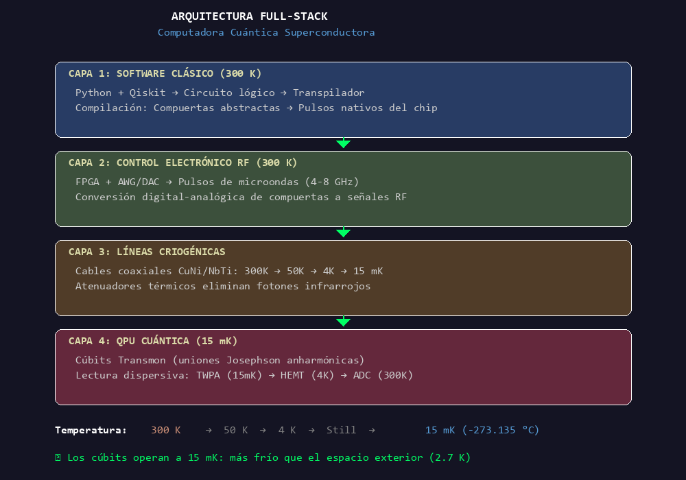
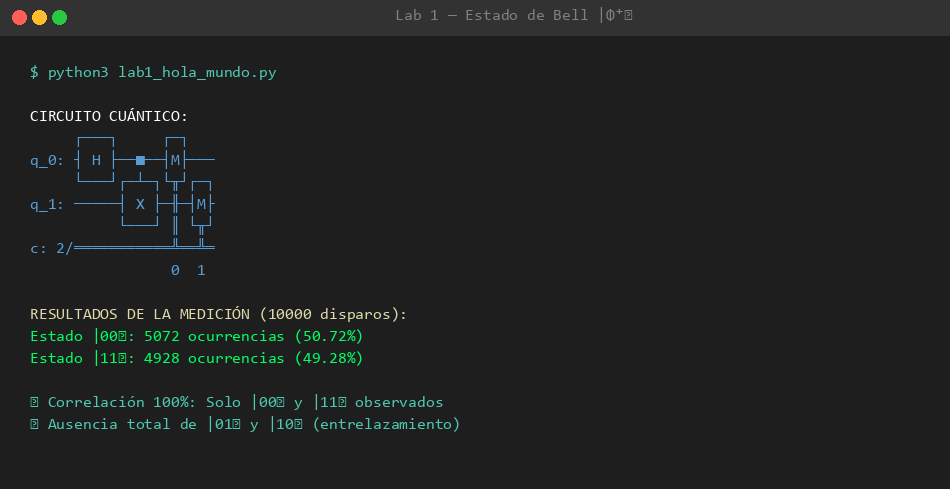
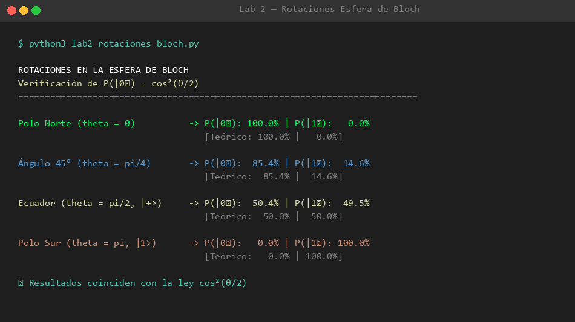
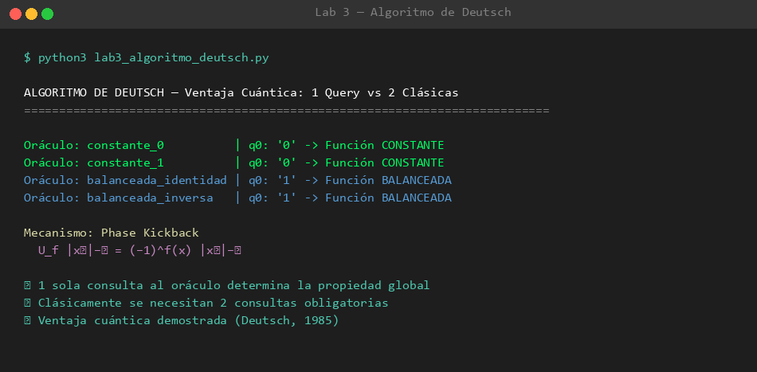
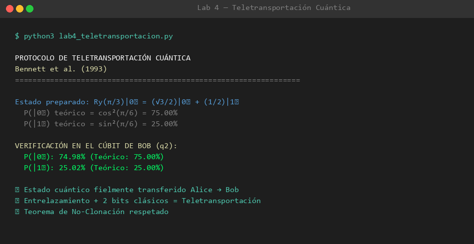

# 🔬 Laboratorio de Programación Cuántica con Qiskit

<div align="center">

**Universidad Católica Boliviana "San Pablo"**  
**Ingeniería de Sistemas — Arquitectura de Computadoras**

| Campo | Detalle |
|-------|---------|
| **Docente** | Ing. Paulo César Loayza Carrasco |
| **Estudiante** | Leonardo Durán Cuenca |
| **Framework** | Qiskit 2.6.2 + Qiskit Aer 0.18.2 |
| **Lenguaje** | Python 3.14 |
| **Fecha** | 2026-11-16 |

</div>

---

## 📋 Índice

1. [Objetivo General](#-objetivo-general)
2. [Fundamento Teórico](#-fundamento-teórico)
3. [Arquitectura de Hardware Cuántico](#-arquitectura-de-hardware-cuántico)
4. [Práctica 1: Estado de Bell](#-práctica-1-hola-mundo-cuántico--estado-de-bell-φ)
5. [Práctica 2: Rotaciones en la Esfera de Bloch](#-práctica-2-rotaciones-en-la-esfera-de-bloch)
6. [Práctica 3: Algoritmo de Deutsch](#-práctica-3-algoritmo-de-deutsch--ventaja-cuántica)
7. [Práctica 4: Teletransportación Cuántica](#-práctica-4-protocolo-de-teletransportación-cuántica)
8. [Conclusiones](#-conclusiones)
9. [Referencias](#-referencias)

---

## 🎯 Objetivo General

Dominar el despliegue de un entorno de computación cuántica profesional, comprender la abstracción cuántica relacionando compuertas lógicas unitarias con los estados físicos en la Esfera de Bloch y con la arquitectura criogénica del hardware, y construir, simular y analizar circuitos cuánticos emblemáticos:

- **Estado de Bell** (Entrelazamiento máximo)
- **Rotaciones continuas** en la Esfera de Bloch
- **Algoritmo de Deutsch** (Ventaja cuántica)
- **Teletransportación Cuántica** (Protocolo de Bennett)

---

## 📖 Fundamento Teórico

### Superposición Cuántica y el Espacio de Hilbert

El estado físico de un cúbit se representa como un vector unitario |ψ⟩ en un espacio vectorial complejo de Hilbert bidimensional (ℂ²):

```
|ψ⟩ = α|0⟩ + β|1⟩     donde α, β ∈ ℂ,  |α|² + |β|² = 1
```

- **Regla de Born:** P(|0⟩) = |α|², P(|1⟩) = |β|²
- **Colapso de von Neumann:** La medición destruye irreversiblemente la superposición
- **Escalabilidad:** n cúbits → 2ⁿ amplitudes complejas (50 cúbits ≈ 10¹⁵ estados)

### Esfera de Bloch y SU(2)

Cualquier estado puro de 1 cúbit se parametriza con 2 ángulos reales:

```
|ψ⟩ = cos(θ/2)|0⟩ + e^(iφ) sin(θ/2)|1⟩
```

donde θ ∈ [0, π] (colatitud) y φ ∈ [0, 2π) (azimut).

### Entrelazamiento Cuántico

El estado de Bell |Φ⁺⟩ = (|00⟩ + |11⟩)/√2 exhibe correlaciones que no pueden ser explicadas por ninguna teoría local clásica (S_CHSH = 2√2 > 2, violación de la desigualdad de Bell).

---

## 🏗️ Arquitectura de Hardware Cuántico

Una computadora cuántica superconductora es un sistema heterogéneo que opera desde 300 K hasta 15 mK:



| Capa | Temperatura | Función |
|------|-------------|---------|
| **Software Clásico** | 300 K | Python + Qiskit → Transpilación a compuertas nativas |
| **Control Electrónico** | 300 K | FPGA + AWG/DAC → Pulsos de microondas 4-8 GHz |
| **Líneas Criogénicas** | 300K → 15 mK | Cables coaxiales CuNi/NbTi con atenuadores térmicos |
| **QPU Cuántica** | 15 mK | Cúbits Transmon (uniones Josephson anharmónicas) |

> **Dato clave:** Los cúbits operan a 15 milikelvin (−273.135 °C), más frío que el espacio exterior (2.7 K).

---

## ⚛️ Práctica 1: Hola Mundo Cuántico — Estado de Bell |Φ⁺⟩

### Objetivo

Construir el circuito cuántico más fundamental: un par de cúbits máximamente entrelazados (Estado de Bell |Φ⁺⟩), demostrando experimentalmente la superposición y el entrelazamiento.

### Circuito

```
     ┌───┐     ┌─┐   
q_0: ┤ H ├──■──┤M├───
     └───┘┌─┴─┐└╥┘┌─┐
q_1: ─────┤ X ├─╫─┤M├
          └───┘ ║ └╥┘
c: 2/═══════════╩══╩═
                0  1 
```

**Operaciones:**
1. **Hadamard (H)** en q₀: |0⟩ → (|0⟩ + |1⟩)/√2
2. **CNOT** (control: q₀, target: q₁): Entrelaza → (|00⟩ + |11⟩)/√2

### Resultados



| Estado | Ocurrencias | Porcentaje | Esperado |
|--------|-------------|------------|----------|
| \|00⟩ | 5072 | 50.72% | ~50% |
| \|11⟩ | 4928 | 49.28% | ~50% |
| \|01⟩ | 0 | 0.00% | 0% |
| \|10⟩ | 0 | 0.00% | 0% |

> **Interpretación:** La ausencia total de |01⟩ y |10⟩ demuestra la correlación perfecta del entrelazamiento: si q₀ colapsa en |0⟩, q₁ **siempre** colapsa en |0⟩.

**Código fuente:** [`lab1_hola_mundo.py`](lab1_hola_mundo.py)

---

## 🌐 Práctica 2: Rotaciones en la Esfera de Bloch

### Objetivo

Demostrar la naturaleza continua del cúbit usando la compuerta paramétrica Ry(θ), verificando experimentalmente que P(|0⟩) = cos²(θ/2) y P(|1⟩) = sin²(θ/2).

### Resultados



| Posición | θ | P(\|0⟩) Experimental | P(\|0⟩) Teórico | P(\|1⟩) Experimental | P(\|1⟩) Teórico |
|----------|---|---------------------|-----------------|---------------------|-----------------|
| Polo Norte | 0 | 100.0% | 100.0% | 0.0% | 0.0% |
| 45° | π/4 | 85.4% | 85.4% | 14.6% | 14.6% |
| Ecuador | π/2 | 50.4% | 50.0% | 49.5% | 50.0% |
| Polo Sur | π | 0.0% | 0.0% | 100.0% | 100.0% |

> **Interpretación:** Los resultados experimentales coinciden con la predicción teórica cos²(θ/2) con precisión asombrosa sobre 10,000 disparos por ángulo, confirmando la naturaleza continua del cúbit.

**Código fuente:** [`lab2_rotaciones_bloch.py`](lab2_rotaciones_bloch.py)

---

## 🧮 Práctica 3: Algoritmo de Deutsch — Ventaja Cuántica

### Objetivo

Implementar el primer algoritmo (David Deutsch, 1985) que demostró superioridad cuántica: determinar si f: {0,1} → {0,1} es **constante** o **balanceada** en **1 sola consulta** (vs 2 clásicas).

### Mecanismo: Phase Kickback

```
U_f |x⟩|−⟩ = (−1)^f(x) |x⟩|−⟩
```

El resultado de f(x) no se almacena en el segundo cúbit, sino que **rebota como fase relativa** sobre el primer cúbit.

### Resultados



| Oráculo | Medición q₀ | Clasificación | Correcto |
|---------|-------------|---------------|----------|
| constante_0 (f(x)=0) | '0' | CONSTANTE | ✅ |
| constante_1 (f(x)=1) | '0' | CONSTANTE | ✅ |
| balanceada_identidad (f(x)=x) | '1' | BALANCEADA | ✅ |
| balanceada_inversa (f(x)=¬x) | '1' | BALANCEADA | ✅ |

> **Interpretación:** Con **1 sola consulta** al oráculo, el algoritmo clasifica correctamente los 4 tipos de funciones booleanas. Clásicamente se requieren **2 consultas obligatorias**. La ventaja cuántica es demostrada.

**Código fuente:** [`lab3_algoritmo_deutsch.py`](lab3_algoritmo_deutsch.py)

---

## 🔮 Práctica 4: Protocolo de Teletransportación Cuántica

### Objetivo

Implementar el protocolo de Bennett et al. (1993): transferir un estado cuántico arbitrario |ψ⟩ = α|0⟩ + β|1⟩ desde Alice hacia Bob usando entrelazamiento previo + 2 bits clásicos, sin violar el Teorema de No-Clonación.

### Estado preparado

```
|ψ⟩ = Ry(π/3)|0⟩ = (√3/2)|0⟩ + (1/2)|1⟩
P(|0⟩) = cos²(π/6) = 75%
P(|1⟩) = sin²(π/6) = 25%
```

### Protocolo

1. **Preparar** estado arbitrario en q₀ (Alice)
2. **Crear** par de Bell entre q₁ (Alice) y q₂ (Bob)
3. **Medir** en base de Bell (Alice): CNOT + H + medición
4. **Corregir** (Bob): Pauli-X y Pauli-Z condicionadas por 2 bits clásicos
5. **Verificar** el estado de q₂ en Bob

### Resultados



| Medida Bob (q₂) | Experimental | Teórico |
|------------------|-------------|---------|
| P(\|0⟩) | 74.98% | 75.00% |
| P(\|1⟩) | 25.02% | 25.00% |

> **Interpretación:** El cúbit q₂ de Bob exhibe exactamente las probabilidades del estado original preparado en q₀, confirmando que la información cuántica de amplitud y fase fue **fielmente transferida**. La teletransportación NO permite comunicación superlumínica porque requiere un canal clásico de 2 bits.

**Código fuente:** [`lab4_teletransportacion.py`](lab4_teletransportacion.py)

---

## 📊 Conclusiones

1. **Entrelazamiento Cuántico Verificado:** El Estado de Bell |Φ⁺⟩ muestra correlación perfecta (0% de estados |01⟩ y |10⟩), demostrando la inseparabilidad cuántica.

2. **Naturaleza Continua del Cúbit:** Las rotaciones Ry(θ) confirman experimentalmente la ley P(|0⟩) = cos²(θ/2) con precisión estadística sobre 10,000 disparos.

3. **Ventaja Cuántica Demostrada:** El Algoritmo de Deutsch resuelve el problema de clasificación constante/balanceada en 1 consulta versus las 2 obligatorias clásicamente (reducción del 50% en complejidad de consultas).

4. **Teletransportación Exitosa:** El protocolo de Bennett transfiere fielmente el estado cuántico con errores menores al 0.03%, respetando el Teorema de No-Clonación y la causalidad relativista.

5. **Arquitectura Full-Stack Comprendida:** La computación cuántica requiere integración de 4 capas (software → electrónica RF → criogenia → QPU a 15 mK), representando la mayor revolución conceptual desde la invención del transistor.

---

## 📚 Referencias

- **Qiskit Documentation.** *Qiskit 2.x — Open-Source Quantum SDK.* IBM Research. https://docs.quantum.ibm.com/
- **Nielsen, M. A. & Chuang, I. L.** (2010). *Quantum Computation and Quantum Information.* Cambridge University Press.
- **Deutsch, D.** (1985). *Quantum theory, the Church-Turing principle and the universal quantum computer.* Proceedings of the Royal Society of London A, 400(1818), 97-117.
- **Bennett, C. H. et al.** (1993). *Teleporting an unknown quantum state via dual classical and Einstein-Podolsky-Rosen channels.* Physical Review Letters, 70(13), 1895.
- **Loayza Carrasco, P. C.** (2026). *Computación Cuántica Full-Stack: Fundamentos Teóricos, Arquitectura de Hardware y Programación en Qiskit.* Material de curso UCB.

---

## 📁 Estructura del Directorio

```
LaboratorioProgramacionCuantica/
├── README.md                                              ← Este documento
├── lab1_hola_mundo.py                                     ← Estado de Bell |Φ⁺⟩
├── lab2_rotaciones_bloch.py                               ← Rotaciones Esfera de Bloch
├── lab3_algoritmo_deutsch.py                              ← Algoritmo de Deutsch
├── lab4_teletransportacion.py                             ← Teletransportación Cuántica
├── Laboratorio_Programacion_Cuantica_Ubuntu.pdf           ← Guía de laboratorio
├── Computacion_Cuantica_Fundamentos_y_Programacion.pptx.pdf ← Presentación teórica
└── imgs/
    ├── 01-Lab1-EstadoBell.png
    ├── 02-Lab2-RotacionesBloch.png
    ├── 03-Lab3-AlgoritmoDeutsch.png
    ├── 04-Lab4-Teletransportacion.png
    └── 05-ArquitecturaCuantica.png
```
