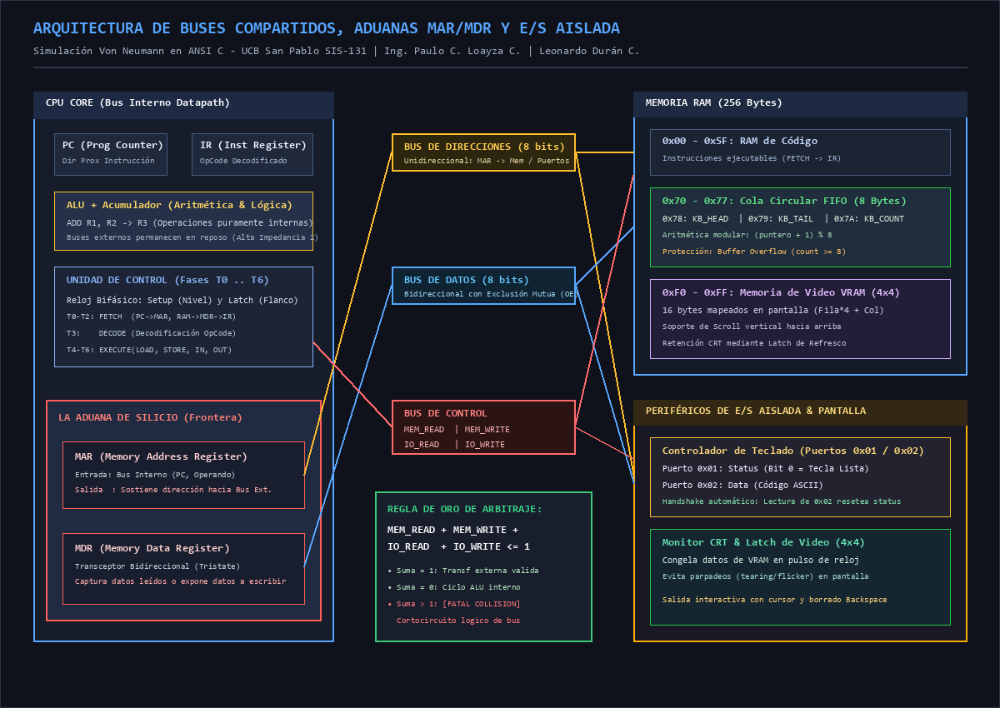
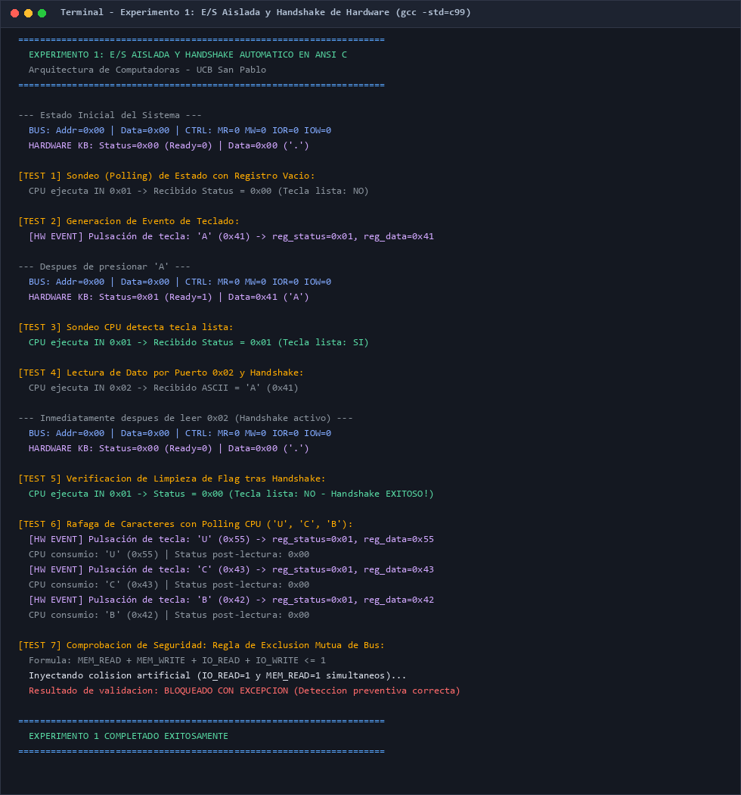
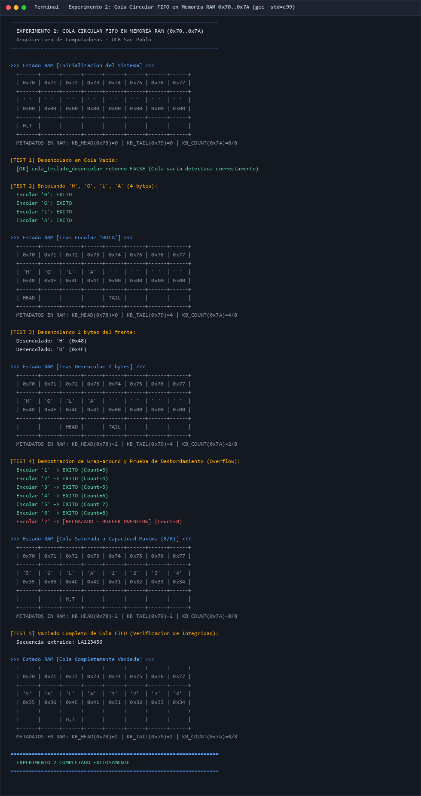
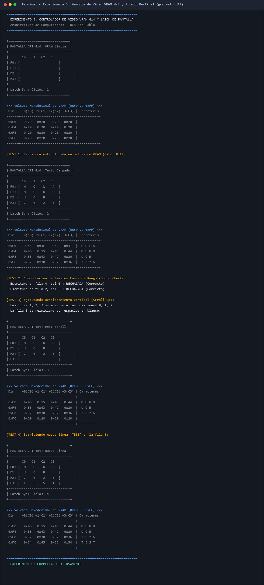
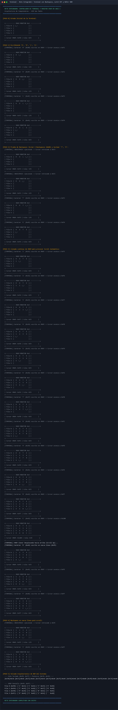

# Laboratorio: E/S Aislada por Puertos, Cola Circular FIFO en RAM y Controlador VRAM

**Universidad Católica Boliviana "San Pablo"**  
**Facultad de Ingeniería — Departamento de Ingeniería de Sistemas**  
**SIS-131: Arquitectura de Computadoras**  
* **Docente:** Ing. Paulo César Loayza Carrasco  
* **Estudiante:** Leonardo Durán Cuenca  
* **Semestre:** 2-2026  
* **Repositorio:** [Arquitectura-Computadoras](https://github.com/Duranzzz/Arquitectura-Computadoras)

---

## 1. Introducción y Marco Teórico

En el diseño y simulación de computadoras bajo la arquitectura clásica de **Von Neumann**, uno de los errores conceptuales más frecuentes es modelar los componentes mediante acoplamientos directos y asignaciones arbitrarias de memoria (por ejemplo, `memoria[dir] = registro`). En los sistemas físicos de silicio y placas madre reales, no existen conductores punto a punto entre cada celda de almacenamiento y cada registro interno.

Este laboratorio implementa y modela formalmente en lenguaje **ANSI C (C89/C99)** la disciplina estricta de **buses compartidos**, el arbitraje de señales de control, el ciclo de micro-pasos temporales (**T-States**), la frontera de aislamiento mediante las aduanas **MAR** (*Memory Address Register*) y **MDR** (*Memory Data Register*), la entrada/salida aislada por puertos (*Isolated I/O*), el búfer de cola circular FIFO en memoria RAM y el controlador de memoria de video **VRAM** con retención (*Latch*) y desplazamiento vertical (*Scroll*).



### 1.1 El Modelo de Bus Compartido y Exclusión Mutua
El bus es un canal común de comunicación donde múltiples emisores y receptores convergen sobre las mismas pistas físicas:
1. **Exclusión Mutua de Transmisión (Un solo emisor):** En cualquier ciclo temporal, exactamente un dispositivo puede habilitar su compuerta de salida (*Output Enable* / $OE = 1$) para inyectar voltaje al bus. Todos los demás componentes conectados deben permanecer en estado de **Alta Impedancia ($Z$)**, actuando como circuitos abiertos para evitar cortocircuitos lógicos o colisiones de bus.
2. **Captura Selectiva (Uno o varios receptores):** Los módulos habilitados mediante su compuerta de carga (*Load* o *Write Enable* / $WE = 1$) absorben los niveles lógicos presentes en el bus al llegar el flanco del reloj.
3. **Regla de Oro de Arbitraje:** En el bus de control externo, la activación simultánea de operaciones incompatibles provoca una excepción de colisión física:
   $$\text{MEM\_READ} + \text{MEM\_WRITE} + \text{IO\_READ} + \text{IO\_WRITE} \le 1$$
   * **Suma = 1:** Operación válida de bus externo (un único periférico o celda de memoria interactúa con la CPU).
   * **Suma = 0:** Operación interna del procesador (cómputo puramente en ALU o transferencia entre registros internos; buses externos en reposo/Hi-Z).
   * **Suma > 1:** **COLISIÓN DE BUS / CORTOCIRCUITO LÓGICO.** El simulador interrumpe inmediatamente el ciclo.

### 1.2 La Frontera de Silicio: Buses Internos vs. Buses Externos (Aduanas MAR y MDR)
El procesador posee dos universos físicos diferenciados:
* **Bus Interno (Datapath de la CPU):** Conecta los registros de propósito general, la ALU, el Acumulador y los registros de control (PC, IR). Es microscópico, ultrarrápido y opera a frecuencias elevadas dentro del dado de silicio.
* **Buses Externos (System Bus):** Pistas de cobre en la tarjeta madre que conectan la CPU con la Memoria RAM y los controladores de periféricos.

Los registros de trabajo nunca interactúan directamente con las líneas externas. Dicha interacción está regulada obligatoriamente por la **Aduana de Frontera**:
* **MAR (Memory Address Register):** Captura direcciones provenientes del bus interno y las sostiene estables hacia el Bus de Direcciones Externo.
* **MDR (Memory Data Register):** Transceptor bidireccional con lógica tri-state que actúa como pasarela para el Bus de Datos Externo, capturando bytes entrantes o exponiendo bytes a escribir.

---

## 2. Mapa de Memoria y Puertos del Sistema

El espacio direccionable de 256 bytes de memoria RAM y el espacio de puertos de Entrada/Salida aislada se organizan de acuerdo a la siguiente distribución arquitectónica:

| Rango Hexadecimal | Componente / Recurso | Función en el Sistema |
| :--- | :--- | :--- |
| `0x00 - 0x5F` | **RAM de Código** | Almacenamiento de instrucciones ejecutables (OpCodes y operandos). |
| `0x70 - 0x77` | **Cola Teclado (FIFO)** | Búfer circular elástico residente en RAM de 8 bytes de capacidad. |
| `0x78` | **Puntero `KB_HEAD`** | Índice en RAM de lectura (0 a 7) para desencolar caracteres. |
| `0x79` | **Puntero `KB_TAIL`** | Índice en RAM de escritura (0 a 7) para encolar pulsaciones. |
| `0x7A` | **Contador `KB_COUNT`** | Cantidad de caracteres acumulados en el búfer circular (0 a 8). |
| `0xF0 - 0xFF` | **Memoria VRAM (Monitor)** | Matriz de video de 4x4 caracteres (16 bytes) con retención por Latch. |
| `Puerto 0x01` | **Registro KB Status** | E/S Aislada: Bit 0 en Alto ($1$) indica tecla física lista para lectura. |
| `Puerto 0x02` | **Registro KB Data** | E/S Aislada: Byte ASCII del carácter; al leerlo ejecuta handshake de reset. |

---

## 3. El Ciclo de Instrucción Unificado (T-States)

Cada instrucción ejecutada por la CPU se descompone en estados temporales discretos ($T_0, T_1, \dots, T_n$) orquestados por el reloj bifásico (*Setup* en nivel alto y *Latch/Capture* en flanco activo):

| Paso | Fase | Microoperación | Bus Interno | Bus Dir. Ext. | Bus Datos Ext. | Bus Control | Registros Afectados |
| :---: | :---: | :--- | :--- | :--- | :--- | :--- | :--- |
| **$T_0$** | FETCH | $PC \to MAR$ | $PC$ expone dirección | (Inactivo) | Alta Imp. ($Z$) | `MAR_Load = 1` | $MAR$ carga dirección |
| **$T_1$** | FETCH | Pedir OpCode; $PC \gets PC + 1$ | (Interno libre) | $MAR$ expone Dir | RAM entrega OpCode | `MEM_READ = 1` | $PC$ incrementa; RAM busca celda |
| **$T_2$** | FETCH | $MDR \to IR$ | $MDR$ expone OpCode | $MAR$ mantiene Dir | RAM entrega dato | `MEM_READ = 1`, `IR_Load = 1` | $IR$ captura OpCode |
| **$T_3$** | DECODE| Decodificar OpCode | (Interno libre) | (Inactivo) | Alta Imp. ($Z$) | Lógica UC | La UC activa el microprograma |
| **$T_4$** | EXEC (IN) | Cargar Puerto a $MAR$ | Operando $\to MAR$ | (Inactivo) | Alta Imp. ($Z$) | `MAR_Load = 1` | $MAR$ almacena puerto |
| **$T_5$** | EXEC (IN) | Leer Periférico | (Interno libre) | $MAR$ expone Puerto| Periférico expone dato | `IO_READ = 1` | $MDR$ absorbe byte |
| **$T_6$** | EXEC (IN) | $MDR \to$ Registro | $MDR$ vuelca dato | (Inactivo) | Alta Imp. ($Z$) | `R_Load = 1`, `RESET_T = 1` | Reg destino carga; $T \gets 0$ |

---

## 4. Desglose de Experimentos y Código Fuente

### 4.1 Experimento 1: E/S Aislada y Handshake de Hardware (`exp1_puerto_teclado.c`)
Modela la instrucción `IN` del procesador mediante el Bus de Control (`IO_READ = true`) y un controlador de teclado periférico. Al consultar el puerto `0x01` mediante *polling*, la CPU detecta si existe un carácter listo. Al leer el puerto de datos `0x02`, el controlador transfiere el código ASCII al bus y automáticamente limpia su bandera de estado (`kb->reg_status = 0x00`), implementando un protocolo de **handshake en hardware** libre de condiciones de carrera.

```c
uint8_t cpu_instruccion_in(uint8_t puerto) {
    g_bus.address_bus = puerto;
    g_bus.io_read     = true;
    g_bus.mem_read    = false;
    tick_controlador_teclado(&g_bus, &g_teclado);
    uint8_t dato = g_bus.data_bus;
    g_bus.io_read     = false;
    return dato;
}

void tick_controlador_teclado(SystemBuses *bus, TecladoHardware *kb) {
    if (bus->io_read) {
        if (bus->address_bus == 0x01) {
            bus->data_bus = kb->reg_status;
        } else if (bus->address_bus == 0x02) {
            bus->data_bus  = kb->reg_data;
            kb->reg_status = 0; /* Handshake automático */
        }
    }
}
```



---

### 4.2 Experimento 2: Cola Circular FIFO en Memoria RAM (`exp2_cola_teclado.c`)
Implementa un búfer circular desacoplador de 8 bytes estrictamente sobre el arreglo de memoria física `g_ram[TAMANO_RAM]`. La gestión de punteros (`DIR_KB_HEAD = 0x78`, `DIR_KB_TAIL = 0x79`) y la cantidad de elementos (`DIR_KB_COUNT = 0x7A`) reside en la propia RAM, utilizando aritmética modular:
$$\text{tail}_{\text{nuevo}} = (\text{tail} + 1) \pmod 8$$
Se incluye detección estricta de **Buffer Overflow** cuando $\text{count} \ge 8$, protegiendo la memoria de sobreescrituras descontroladas en ráfagas de entrada.

```c
bool cola_teclado_encolar(uint8_t ascii) {
    uint8_t tail = g_ram[DIR_KB_TAIL], count = g_ram[DIR_KB_COUNT];
    if (count >= COLA_CAPACIDAD) return false; /* BUFFER OVERFLOW */
    g_ram[COLA_BASE_DIR + tail] = ascii;
    g_ram[DIR_KB_TAIL]  = (tail + 1) % COLA_CAPACIDAD;
    g_ram[DIR_KB_COUNT] = count + 1;
    return true;
}

bool cola_teclado_desencolar(uint8_t *salida_ascii) {
    uint8_t head = g_ram[DIR_KB_HEAD], count = g_ram[DIR_KB_COUNT];
    if (count == 0) return false; /* COLA VACÍA */
    *salida_ascii = g_ram[COLA_BASE_DIR + head];
    g_ram[DIR_KB_HEAD]  = (head + 1) % COLA_CAPACIDAD;
    g_ram[DIR_KB_COUNT] = count - 1;
    return true;
}
```



---

### 4.3 Experimento 3: Memoria de Video VRAM y Scroll Vertical (`exp3_vram_monitor.c`)
Mapea una pantalla de 4 filas por 4 columnas en el rango de direcciones `0xF0` a `0xFF`:
$$\text{Dirección} = \text{0xF0} + (\text{Fila} \times 4) + \text{Columna}$$
Incluye comprobación de límites (*bound checks*), desplazamiento vertical hacia arriba (*scroll up*) copiando las filas $1, 2, 3$ hacia las posiciones $0, 1, 2$ e inicializando la fila inferior con espacios en blanco (`0x20`), y un **Latch de refresco** que retiene la imagen para evitar el parpadeo (*flickering*) en pantalla durante las escrituras de la CPU.

```c
bool vram_escribir(uint8_t fila, uint8_t col, char c) {
    if (fila >= 4 || col >= 4) return false;
    uint8_t dir = 0xF0 + (fila * 4) + col;
    g_ram[dir] = (uint8_t)c;
    return true;
}

void vram_scroll_arriba(void) {
    for (int f = 0; f < 3; f++) {
        for (int c = 0; c < 4; c++) {
            g_ram[0xF0 + (f * 4) + c] = g_ram[0xF0 + ((f + 1) * 4) + c];
        }
    }
    for (int c = 0; c < 4; c++) {
        g_ram[0xF0 + (3 * 4) + c] = 0x20;
    }
}
```



---

### 4.4 Reto Integrador: Terminal con Backspace y Búfer RAM (`reto_integrador_terminal.c`)
Integra la totalidad del sistema de cómputo:
1. Las pulsaciones físicas disparan eventos en el controlador de teclado y la rutina de servicio (**ISR**) lee los puertos `0x01` y `0x02`, depositando los caracteres en la cola FIFO de RAM (`0x70..0x77`).
2. El procesador de terminal desencola caracteres y actualiza el cursor `cursor_vram`.
3. **Manejo de Backspace (`0x08` / `0x7F`):** Si `cursor_vram > 0xF0`, el cursor retrocede y escribe un espacio `0x20` en la celda correspondiente de la RAM, borrando el carácter visible.
4. **Desplazamiento Automático:** Al alcanzar el límite inferior de la pantalla (`0xFF`), las nuevas entradas disparan `vram_scroll_arriba()`, reposicionando el cursor y manteniendo la visibilidad del flujo de texto continuo.

```c
bool terminal_procesar_siguiente_tecla(void) {
    uint8_t tecla;
    if (!cola_teclado_desencolar(&tecla)) return false;

    if (tecla == 0x08 || tecla == 0x7F) { /* BACKSPACE */
        if (g_pc.cursor_vram > 0xF0) {
            g_pc.cursor_vram--;
            g_pc.ram[g_pc.cursor_vram] = 0x20; /* Borra carácter */
        }
    } else if (tecla >= 32 && tecla <= 126) {
        if (g_pc.cursor_vram <= 0xFF) {
            g_pc.ram[g_pc.cursor_vram] = tecla;
            g_pc.cursor_vram++;
        } else {
            vram_scroll_arriba();
            g_pc.cursor_vram = 0xFC;
            g_pc.ram[g_pc.cursor_vram] = tecla;
            g_pc.cursor_vram++;
        }
    }
    monitor_actualizar_pantalla();
    return true;
}
```



---

## 5. Instrucciones de Compilación y Ejecución

Todos los módulos fueron programados bajo el estándar **ANSI C99** y validados con **GCC** habilitando la totalidad de advertencias del compilador:

```bash
# Navegar a la carpeta del laboratorio
cd LaboratorioPuertosColaVRAM

# Compilación de Experimento 1: E/S Aislada
gcc -std=c99 -Wall -Wextra -pedantic exp1_puerto_teclado.c -o exp1

# Compilación de Experimento 2: Cola Circular FIFO en RAM
gcc -std=c99 -Wall -Wextra -pedantic exp2_cola_teclado.c -o exp2

# Compilación de Experimento 3: VRAM 4x4 y Latch
gcc -std=c99 -Wall -Wextra -pedantic exp3_vram_monitor.c -o exp3

# Compilación de Reto Integrador: Terminal Completa
gcc -std=c99 -Wall -Wextra -pedantic reto_integrador_terminal.c -o reto_terminal
```

### Ejecución de los Programas:
```bash
./exp1
./exp2
./exp3
./reto_terminal
```

---

## 6. Conclusiones y Análisis Arquitectónico

1. **Aislamiento por Aduanas:** El desacoplamiento entre el Datapath interno y las pistas físicas externas mediante los registros `MAR` y `MDR` garantiza la integridad del sistema. Ninguna línea de datos externa puede inducir ruido o sobretensiones directas sobre los registros de trabajo de la CPU.
2. **Eficiencia del Handshake de Hardware:** El reinicio automático del bit de estado (`kb->reg_status = 0`) tras la lectura del puerto `0x02` elimina la necesidad de comandos explícitos de borrado (*software acknowledgment*), ahorrando ciclos de reloj críticos y evitando lecturas duplicadas en bucles de sondeo (*polling*).
3. **Resiliencia de la Cola Circular en RAM:** Mantener el búfer elástico y sus punteros directamente en celdas de RAM (`0x70..0x7A`) modela con fidelidad la arquitectura de memoria uniforme de los microcontroladores y computadoras Von Neumann. La detección preventiva de *Buffer Overflow* evita corrupciones en las áreas de código o de video adyacentes.
4. **Independencia Visual del Latch:** El circuito de retención (*Latch*) del monitor permite que la CPU escriba ráfagas de caracteres en VRAM a velocidades de nanosegundos sin provocar anomalías visuales (*tearing*) en la pantalla, sincronizando la visualización con el haz de escaneo del monitor.
