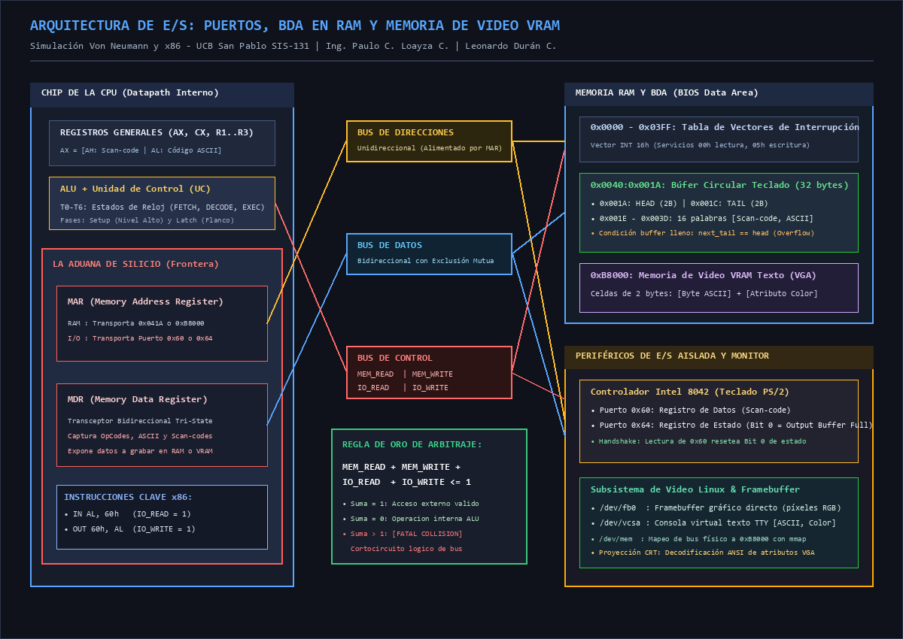
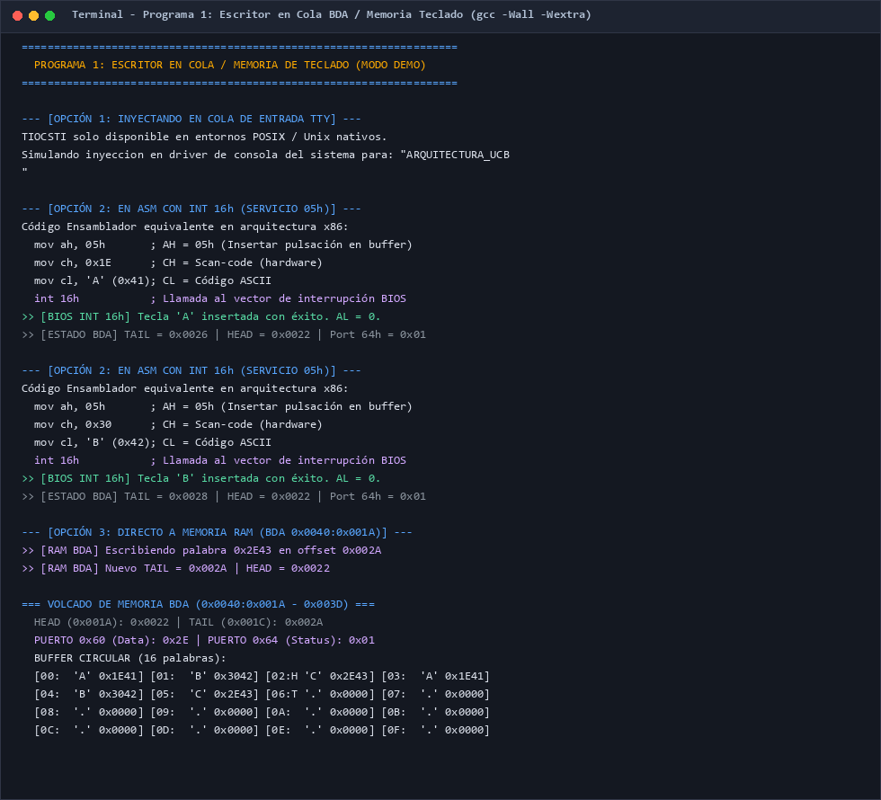
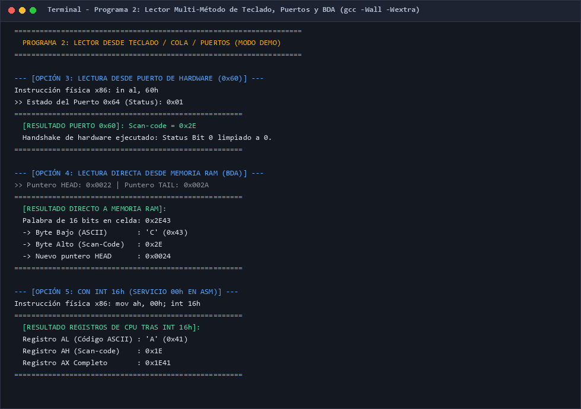
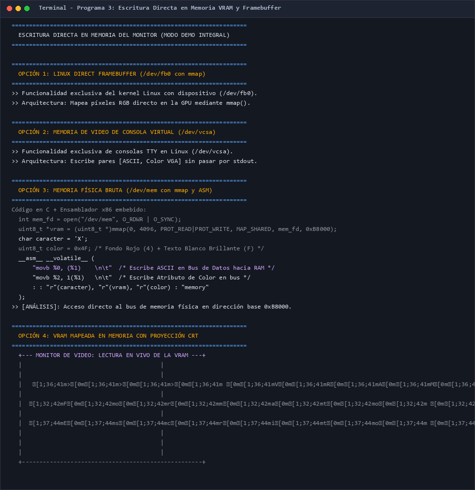

# Laboratorio: Entradas, Salidas por Puertos, BDA en RAM y Memoria de Video (VRAM)

**Universidad Católica Boliviana "San Pablo"**  
**Facultad de Ingeniería — Departamento de Ingeniería de Sistemas**  
**SIS-131: Arquitectura de Computadoras**  
* **Docente:** Ing. Paulo César Loayza Carrasco  
* **Estudiante:** Leonardo Durán Cuenca  
* **Semestre:** 2-2026  
* **Repositorio:** [Arquitectura-Computadoras](https://github.com/Duranzzz/Arquitectura-Computadoras)

---

## 1. Fundamentos Arquitectónicos y Marco Teórico

En el diseño e implementación de arquitecturas basadas en el modelo **Von Neumann / x86**, la CPU nunca realiza transferencias de datos directas ni acoplamientos punto a punto con los periféricos o la memoria. Todo intercambio de información está rigurosamente canalizado a través del **Sistema de Buses** y custodiado por los registros de frontera (**Aduanas de Silicio**).



### 1.1 Comportamiento y Disciplina de los Tres Buses del Sistema

1. **Bus de Direcciones (*Address Bus* - Unidireccional: CPU $\to$ Dispositivos):**
   * Transporta la coordenada física o número de puerto al que se desea acceder.
   * Es alimentado exclusivamente por el registro **MAR** (*Memory Address Register*).
   * Si la operación es de memoria, direcciona celdas en RAM (ej. BDA en `0x0040:0x001A` o VRAM en `0xB8000`).
   * Si la operación es de E/S aislada, transporta el número de puerto (ej. `0x60` o `0x64`).

2. **Bus de Datos (*Data Bus* - Bidireccional: CPU $\leftrightarrow$ Dispositivos):**
   * Transporta la carga útil: códigos de operación, operandos, bytes ASCII o scan-codes de hardware.
   * Conectado internamente al transceptor tri-state **MDR** (*Memory Data Register*).
   * **Regla de Oro:** En cualquier ciclo de reloj, exactamente un componente tiene habilitada su compuerta de salida (*Output Enable* / $OE = 1$). El resto debe mantenerse en **Alta Impedancia ($Z$)**.

3. **Bus de Control (*Control Bus* - Señales de Mando y Temporización):**
   * Gobernado por la Unidad de Control (UC). Las cuatro líneas vitales son:
     * $\text{MEM\_READ} = 1$: Despierta a la Memoria RAM para colocar en el bus de datos la celda seleccionada.
     * $\text{MEM\_WRITE} = 1$: Ordena a la Memoria RAM grabar el valor flotante en el bus de datos.
     * $\text{IO\_READ} = 1$: Inhibe a la RAM y activa al controlador periférico (ej. Puerto `0x60`) para volcar su dato.
     * $\text{IO\_WRITE} = 1$: Inhibe a la RAM y ordena al periférico capturar el dato presente en el bus.
   * **Ecuación de No Colisión / Arbitraje:**
     $$\text{MEM\_READ} + \text{MEM\_WRITE} + \text{IO\_READ} + \text{IO\_WRITE} \le 1$$
     * Suma = 1: Acceso externo válido.
     * Suma = 0: Operación puramente interna en la ALU/registros (buses externos en reposo/Hi-Z).
     * Suma > 1: **Error fatal de colisión de bus (cortocircuito lógico).**

---

## 2. Mapa Arquitectónico de Memoria y Puertos x86

| Rango Hexadecimal | Segmento / Recurso | Función Arquitectónica |
| :--- | :--- | :--- |
| `0x0000 - 0x03FF` | **IVT (Interrupt Vector Table)** | 256 vectores de interrupción (ej. `INT 16h` para servicios de teclado). |
| `0x0040:0x001A` | **BDA: KB_HEAD (2 bytes)** | Offset de lectura en el buffer circular de teclado. |
| `0x0040:0x001C` | **BDA: KB_TAIL (2 bytes)** | Offset de escritura para nuevas pulsaciones de teclado. |
| `0x0040:0x001E - 0x003D`| **BDA: Buffer Teclado (32 bytes)** | Cola circular FIFO de 16 palabras: `[Scan-code MSB, ASCII LSB]`. |
| `0xB8000 - 0xBFFFF`| **VRAM Modo Texto VGA** | Memoria de video mapeada: celdas de 2 bytes `[ASCII] + [Color]`. |
| **Puerto 0x60** | **Data Port (Intel 8042)** | E/S Aislada: Lectura de Scan-code del teclado (`in al, 60h`). |
| **Puerto 0x64** | **Status Register (Intel 8042)**| E/S Aislada: Bit 0 ($1 = \text{Output Buffer Full}$, tecla lista). |

---

## 3. Desglose de Programas y Resultados de Ejecución

### 3.1 Programa 1: Escritor en Cola / Memoria de Teclado (`prog1_escribir_cola.c`)
Implementa los tres mecanismos de inserción de teclas en la arquitectura:
1. **Inyección en TTY (`ioctl(TIOCSTI)`):** Inyecta caracteres en la cola de terminal del sistema operativo simulando el cierre mecánico de contactos.
2. **Servicio BIOS INT 16h (AH = 05h):** Inserta la pulsación en el buffer circular BDA. Si $\text{next\_tail} == \text{head}$, detecta **Buffer Overflow** retornando $\text{AL} = 1$.
3. **Escritura Directa a Memoria BDA:** Modela el acceso sin pasar por el BIOS, calculando el offset $(\text{tail} - \text{0x001E}) / 2$, escribiendo la palabra de 16 bits y avanzando el puntero $\text{TAIL}$.

```c
void metodo_asm_int16(char ascii, uint8_t scan_code) {
    BiosKeyboardMemory bda;
    cargar_bda(&bda);
    uint16_t next_tail = (bda.tail >= 0x003C) ? 0x001E : bda.tail + 2;
    if (next_tail == bda.head) {
        printf(">> [BIOS INT 16h] AL = 1: BUFFER OVERFLOW. Buffer lleno.\n");
        return;
    }
    int idx = (bda.tail - 0x001E) / 2;
    bda.buffer[idx] = ((uint16_t)scan_code << 8) | (uint8_t)ascii;
    bda.tail = next_tail;
    bda.port_60_data = scan_code;
    bda.port_64_status |= 0x01;
    guardar_bda(&bda);
}
```



---

### 3.2 Programa 2: Lector Multi-Método (`prog2_leer_teclado.c`)
Evalúa los distintos niveles de abstracción para la lectura de pulsaciones:
1. **Nivel Aplicación (`scanf` y `getc`):** Extrae del buffer estándar de entrada formateado y por caracteres.
2. **Nivel Hardware / Puerto (`in al, 60h`):** Comprueba el bit 0 del puerto `0x64`, lee el scan-code en el puerto `0x60` y ejecuta el **handshake automático** limpiando el flag de estado.
3. **Nivel Memoria Física (BDA):** Lee la celda apuntada por `HEAD`, descompone el byte bajo (ASCII) y el byte alto (Scan-code), y avanza el puntero de lectura circular $(\text{head} + 2) \pmod{32}$.
4. **Nivel BIOS (`INT 16h, AH = 00h`):** Emula la extracción del buffer y la asignación a los registros de la CPU: $\text{AL} = \text{ASCII}$, $\text{AH} = \text{Scan-code}$, $\text{AX} = \text{Palabra completa}$.

```c
void lectura_desde_puerto(void) {
    BiosKeyboardMemory bda;
    cargar_bda(&bda);
    if ((bda.port_64_status & 0x01) == 0 && bda.port_60_data == 0) {
        printf(">> [PUERTO 0x60] No hay datos pendientes en el puerto.\n");
    } else {
        uint8_t scan_code = bda.port_60_data;
        bda.port_64_status &= ~0x01; /* Handshake de hardware */
        guardar_bda(&bda);
        printf("  [RESULTADO PUERTO 0x60]: Scan-code = 0x%02X\n", scan_code);
    }
}
```



---

### 3.3 Programa 3: Escritura Directa en Memoria del Monitor (`escribir_monitor_linux.c`)
Demuestra el control directo de los dispositivos de salida de video:
1. **Linux Direct Framebuffer (`/dev/fb0` con `mmap`):** Accede a la VRAM gráfica física mapeando la memoria de la GPU y manipulando píxeles en formato RGB subyacente.
2. **Consola Virtual (`/dev/vcsa`):** Escribe directamente en el búfer de texto de la TTY mediante pares contiguos `[Byte ASCII, Atributo Color VGA]`.
3. **Memoria Física Bruta (`/dev/mem` en `0xB8000` con Ensamblador Embebido):** Ejecuta instrucciones de hardware `movb %0, (%1)` y `movb %2, 1(%1)` para inyectar datos directamente al bus de datos hacia la tarjeta gráfica.
4. **VRAM Didáctica con Proyección CRT:** Asigna un bloque contiguo de memoria con estructura empaquetada `CeldaVram` (`__attribute__((packed))`), escribe mensajes mediante punteros en C y los proyecta decodificando los bits de fondo, primer plano e intensidad en secuencias de escape ANSI.

```c
typedef struct {
    uint8_t ascii;
    uint8_t attribute;
} __attribute__((packed)) CeldaVram;

void opcion_linux_shm_simulada(void) {
    CeldaVram vram[SHM_FILAS * SHM_COLS];
    CeldaVram *pvram = vram;
    // Asignación directa en VRAM mediante coordenadas: fila * COLS + col
    pvram[2 * SHM_COLS + 3 + i].ascii     = (uint8_t)linea1[i];
    pvram[2 * SHM_COLS + 3 + i].attribute = 0x1E; // Fondo Azul + Texto Amarillo
}
```



---

## 4. Compilación y Ejecución

Compilación con el compilador **GCC** habilitando la totalidad de advertencias (`-Wall -Wextra -pedantic`):

```bash
# Navegar a la carpeta del laboratorio
cd LaboratorioTecladoMonitorBuses

# Compilación de Programa 1: Escritor en Cola BDA
gcc -Wall -Wextra -pedantic prog1_escribir_cola.c -o prog1

# Compilación de Programa 2: Lector Multi-Método
gcc -Wall -Wextra -pedantic prog2_leer_teclado.c -o prog2

# Compilación de Programa 3: Escritura Directa en Memoria de Video
gcc -Wall -Wextra -pedantic escribir_monitor_linux.c -o monitor_linux
```

### Modos de Ejecución:
* **Modo Demostración / Automático:**
  ```bash
  ./prog1 --demo
  ./prog2 --demo
  ./monitor_linux --demo
  ```
* **Modo Interactivo (Menús):**
  ```bash
  ./prog1
  ./prog2
  ./monitor_linux
  ```

---

## 5. Conclusiones y Síntesis Arquitectónica

1. **Aislamiento por Puertos vs. Mapeo en Memoria:** La arquitectura x86 demuestra la coexistencia de dos paradigmas: el espacio de E/S aislada accesible exclusivamente mediante `IN/OUT` sobre los puertos `0x60/0x64`, y el espacio de memoria unificado donde residen el búfer circular BDA (`0x0040:0x001A`) y la memoria de video VRAM (`0xB8000`).
2. **Desacoplamiento Mediante Búferes Circulares:** La estructura circular del BDA gestionada por punteros `HEAD` y `TAIL` desacopla la velocidad asíncrona de las pulsaciones humanas respecto al ciclo de ejecución de la CPU, evitando bloqueos y gestionando situaciones de saturación mediante la detección de desbordamiento (`next_tail == head`).
3. **Eficiencia de la VRAM Empaquetada:** Al almacenar cada celda de video en exactamente 2 bytes contiguos (`[ASCII, Color]`), la controladora de video puede alimentar los circuitos de barrido CRT con un único ciclo de acceso a memoria por carácter, optimizando el ancho de banda del bus de gráficos.
4. **Protección de la MMU en Sistemas Modernos:** En sistemas operativos contemporáneos con modo protegido (como Linux), el acceso directo a puertos o a direcciones físicas como `0xB8000` está restringido al Ring 0 (Kernel). Los mecanismos de `/dev/fb0`, `/dev/vcsa` y `mmap` proveen la abstracción segura para interactuar con la memoria física sin comprometer la estabilidad del sistema.
