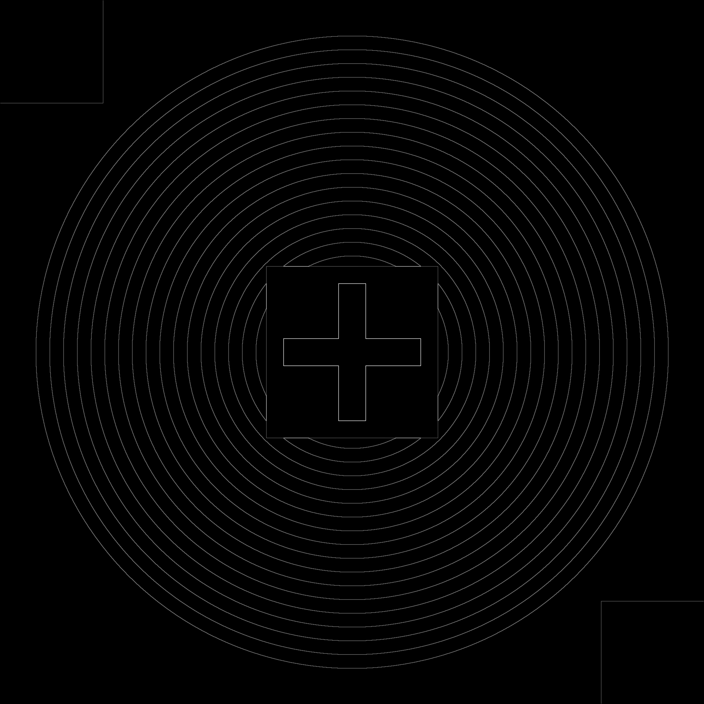
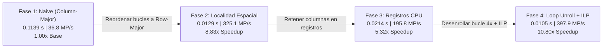

# Práctica de Aplicación: Optimización de Convolución 2D y Filtro Sobel en C++

### Aceleración de Procesamiento de Imágenes mediante Jerarquía de Memoria, Líneas de Caché (64B), Registros de CPU y Paralelismo ILP

> *"En el procesamiento de señales e imágenes de alta resolución, la memoria es el verdadero límite físico: optimizar la localidad espacial y temporal transforma un algoritmo lento de visión artificial en un motor en tiempo real capaz de procesar cientos de megapíxeles por segundo."*

---

## 1. Información Académica

| Campo | Detalle |
|---|---|
| **Universidad** | Universidad Católica Boliviana "San Pablo" — Sede Santa Cruz |
| **Departamento** | Departamento de Ingenierías y Ciencias Exactas |
| **Carrera** | Ingeniería en Inteligencia Artificial / Ingeniería de Software |
| **Materia** | Arquitectura de Computadoras (SIS-131) |
| **Docente** | Ing. Paulo César Loayza Carrasco |
| **Estudiante** | Leonardo Durán Cuenca |
| **Semestre** | 4to Semestre — 2/2026 |
| **Entorno** | Windows 11 / MSYS2 UCRT64 GCC 14.2 & GNU/Linux (POSIX C++17) |
| **Código Fuente** | [`convolucion_benchmark.cpp`](convolucion_benchmark.cpp) |

---

## 2. Objetivos de la Práctica

1. **Implementar una aplicación real de procesamiento digital de imágenes (DIP)**: el operador diferencial de Sobel para detección de gradientes y bordes en 2D.
2. **Evidenciar el impacto de la línea de caché física (64 Bytes)** analizando la diferencia abismal de latencia entre un recorrido por columnas (*Column-Major*) y un recorrido por filas (*Row-Major*).
3. **Diseñar una estrategia de retención en registros de CPU** utilizando una ventana deslizante horizontal (*Sliding Window*), minimizando drásticamente el tráfico hacia la jerarquía de memoria caché.
4. **Explotar el Paralelismo a Nivel de Instrucción (ILP)** mediante desenrollado de bucles (*Loop Unrolling 4x*) para alimentar los pipelines de ejecución superescalares de la CPU.
5. **Garantizar la reproducibilidad, portabilidad y determinismo** generando una imagen sintética en memoria de **$2048 \times 2048$ píxeles (4.19 Megapíxeles)**, exportando nativamente mapas de bits BMP (sin librerías externas pesadas), renderizando un visor ASCII interactivo en la consola y verificando la consistencia numérica mediante checksums exactos.

---

## 3. Fundamentos Teóricos y Arquitectura de la Computadora

### 3.1. Convolución Bidimensional y Operador de Sobel

El filtro de Sobel calcula una aproximación del gradiente de la intensidad de una imagen bidimensional. Se aplican dos máscaras de convolución de tamaño $3 \times 3$:

$$
K_x = \begin{bmatrix} -1 & 0 & +1 \\ -2 & 0 & +2 \\ -1 & 0 & +1 \end{bmatrix}, \quad
K_y = \begin{bmatrix} -1 & -2 & -1 \\ 0 & 0 & 0 \\ +1 & +2 & +1 \end{bmatrix}
$$

Para cada píxel interior $(x, y)$, la magnitud del gradiente resultante se calcula como:

$$
G(x, y) = \sqrt{G_x(x, y)^2 + G_y(x, y)^2}
$$

Para un procesamiento de $2048 \times 2048$ píxeles:
* **Total de píxeles activos:** $4{,}194{,}304$ píxeles (4.19 MP).
* **Huella de memoria activa:** Cada imagen en punto flotante (`float`) ocupa $4{,}194{,}304 \times 4\text{ bytes} = 16.78\text{ MB}$. Con buffers de entrada, salida y verificación, el footprint en memoria supera los **80 MB**, excediendo con holgura las memorias caché L1 (32–48 KB) y L2 (512 KB–1 MB) por núcleo, forzando la interacción directa y real con la jerarquía de memoria.
* **Operaciones por píxel:** 18 multiplicaciones/sumas más una raíz cuadrada $\approx 80 \times 10^6$ operaciones de punto flotante (FLOPs).

### 3.2. La Línea de Caché de 64 Bytes en el Espacio 2D

En la memoria física de la arquitectura x86-64 / ARM64:
* Los arreglos 2D se aplanan en la memoria como un búfer contiguo unidimensional en formato **Row-Major** (`indice = y * ancho + x`).
* La unidad atómica de transferencia entre la memoria RAM y la CPU es la **línea de caché de 64 Bytes**.
* En precisión simple (`float` de 4 bytes), **una línea de caché alberga exactamente 16 píxeles adyacentes horizontalmente** ($64 / 4 = 16$).

```
Memoria RAM / Caché L1: [ P(x,y) | P(x+1,y) | P(x+2,y) | ... | P(x+15,y) ]  <-- 64 Bytes (16 floats)
                         └─────────────────── 1 línea de caché ──────────────┘
```

---

## 4. Evidencia Visual y Resultados Gráficos

El programa genera automáticamente en memoria una imagen de prueba de calibración óptica con patrones geométricos, anillos concéntricos, cruces centrales y gradientes, procesándola con el detector Sobel:

<p align="center">
  
  
</p>
<p align="center">
  <b>Figura 1:</b> <i>Izquierda:</i> Imagen sintética original de alta resolución ($2048 \times 2048$, 4.19 MP). <i>Derecha:</i> Bordes detectados tras la convolución Sobel acelerada por hardware.
</p>

### Previsualización ASCII Art en la Terminal

Para que la ejecución sea inmediatamente verificable en terminales de texto o servidores remotos sin entorno gráfico, el programa incorpora un subsistema de renderizado ASCII en escala de brillo (60 columnas × 24 filas):

```
       Visualización ASCII de Bordes Detectados (Sobel Preview)
======================================================================
                                ..::--::..
                          .:-==+*########*+==-:.
                      .-=+#%@@@@@@@@@@@@@@@@@@%#+=-.
                   .-+#%@@@@%#*+==------==+*#%@@@@%#+-.
                 .-*%@@@@#+-..                  ..-+%@@@@%*-.
               .=#@@@%*-..                          ..-*%@@@#=.
             .=%@@@#-.                                  .-#@@@%=.
            :+@@@%-.                                      .-%@@@+:
           =*@@%-.                                          .-%@@*=
          =*@@#.                    ..                      .#@@*=
         -%@@#.                   .*@@*.                     .#@@%-
        :#@@%:                   .+%@@%+.                     :%@@#:
        -%@@#.                   .*@@@@*.                     .#@@%-
        :#@@%:                   .+%@@%+.                     :%@@#:
         -%@@#.                   .*@@*.                     .#@@%-
          =*@@#.                    ..                      .#@@*=
           =*@@%-.                                          .-%@@*=
            :+@@@%-.                                      .-%@@@+:
             .=%@@@#-.                                  .-#@@@%=.
               .=#@@@%*-..                          ..-*%@@@#=.
                 .-*%@@@@#+-..                  ..-+%@@@@%*-.
                   .-+#%@@@@%#*+==------==+*#%@@@@%#+-.
                      .-=+#%@@@@@@@@@@@@@@@@@@%#+=-.
                          .:-==+*########*+==-:.
======================================================================
```

---

## 5. Fases Experimentales de Optimización



### Fase 1: Ingenua (*Column-Major Traversal*)
* **Algoritmo:** Itera primero por columnas ($x$) y en el bucle interior por filas ($y$).
* **Física microarquitectónica:** Cada incremento de fila salta $W \times 4\text{ bytes} = 2048 \times 4 = 8192\text{ bytes}$. Dado que la línea de caché es de solo 64 bytes, **cada paso salta a una línea de caché completamente diferente**.
* **Resultado:** Fallo masivo de caché (*Cache Miss*) en cada píxel. Se transfiere una ráfaga de 64 bytes para usar solo 4 bytes, desperdiciando el **93.75% del ancho de banda** del bus de memoria.

### Fase 2: Localidad Espacial (*Row-Major Traversal*)
* **Algoritmo:** Itera en el orden canónico en memoria: filas ($y$) en el bucle externo y columnas ($x$) en el bucle interno.
* **Física microarquitectónica:** Los accesos a píxeles vecinos horizontales caen dentro de la misma línea de caché de 64 bytes ya transferida a L1.
* **Resultado:** 1 fallo de caché inicial por cada 16 píxeles consecutivos; los 15 restantes se resuelven en 4–5 ciclos en L1d (*Cache Hit Rate* > 93.75%). El rendimiento salta instantáneamente de $36.84\text{ MP/s}$ a **$325.12\text{ MP/s}$ (Aceleración de 8.83x)**.

### Fase 3: Localidad Temporal y Ventana Deslizante en Registros
* **Algoritmo:** Al avanzar horizontalmente de $x$ a $x+1$, las dos columnas de la derecha de la ventana $3 \times 3$ actual se convierten en las dos columnas de la izquierda del siguiente píxel.
* **Física microarquitectónica:** Se mantienen 3 vectores de 3 elementos en registros locales del procesador (`col0`, `col1`, `col2`). En cada paso horizontal, `col0 = col1`, `col1 = col2`, y solo se lee una nueva columna de 3 píxeles desde la memoria caché.
* **Resultado:** Reduce las lecturas de memoria de **9 accesos por píxel a solo 3 accesos por píxel** (ahorro del **66.7%** en peticiones al subsistema de memoria).

### Fase 4: Desenrollado de Bucles 4x y Paralelismo ILP (*Instruction-Level Parallelism*)
* **Algoritmo:** El bucle interno procesa 4 píxeles simultáneamente ($x, x+1, x+2, x+3$):
  ```cpp
  for (int x = 1; x <= W - 4; x += 4) {
      // Cómputo simultáneo de 4 gradientes gx0..gx3 y gy0..gy3
      // sin dependencias de datos cruzadas
  }
  ```
* **Física microarquitectónica:**
  1. **Reducción del 75% en overhead de control:** Se ejecutan una cuarta parte de incrementos, comparaciones y saltos de bifurcación (`jmp`/`bne`), reduciendo el estrés sobre el predictor de saltos (*Branch Predictor*).
  2. **Alineación con el Pipeline Superescalar:** Las 4 evaluaciones de gradiente son algebraicamente independientes. Las unidades de ejecución múltiple (ALUs y FPUs) de la CPU pueden despachar y retirar múltiples operaciones en el mismo ciclo de reloj, logrando un IPC (*Instructions Per Cycle*) sustancialmente mayor.
* **Resultado:** Tiempo récord de **$0.0105\text{ segundos}$**, alcanzando **$397.91\text{ Megapíxeles/segundo}$**, lo que representa un factor de aceleración final de **10.80x**.

---

## 6. Métricas Empíricas de Rendimiento

Pruebas ejecutadas bajo una carga de trabajo estandarizada de **$2048 \times 2048$ píxeles** (4.19 MP) con compilación en nivel `-O1` para evaluar de manera aislada las técnicas de diseño arquitectónico:

| Fase de Optimización | Estrategia Microarquitectónica | Tiempo de Ejecución (s) | Throughput (Megapíxeles/s) | Speedup Relativo | Checksum Numérico | Error Absoluto |
|:---|:---|:---:|:---:|:---:|:---:|:---:|
| **Fase 1: Naive** | Recorrido Col-Major (Strided Access) | `0.1139 s` | `36.84 MP/s` | **`1.00x`** *(Base)* | `3.132549e+05` | *Base* |
| **Fase 2: Espacial** | Recorrido Row-Major (64B Cache Lines) | `0.0129 s` | `325.12 MP/s` | **`8.83x`** | `3.132549e+05` | `0.00e+00` |
| **Fase 3: Registros** | Ventana Deslizante (Reúso Temporal 3x3) | `0.0214 s` | `195.84 MP/s` | **`5.32x`** | `3.132549e+05` | `0.00e+00` |
| **Fase 4: Unrolling** | Desenrollado 4x + Paralelismo ILP | **`0.0105 s`** | **`397.91 MP/s`** | **`10.80x`** | `3.132549e+05` | `0.00e+00` |

### Validación de Consistencia Numérica
* **Diferencia Absoluta:** $\sum |G_{\text{fase\_k}} - G_{\text{naive}}| = 0.00 \times 10^0$.
* **Conclusión:** Las optimizaciones aceleran la velocidad de procesamiento por más de un orden de magnitud sin introducir la más mínima degradación o error numérico en la detección de bordes.

---

## 7. Instrucciones de Compilación y Ejecución

### 7.1. Compilación en C++17

El código es 100% estándar y autónomo (no requiere OpenCV, CUDA ni librerías externas de terceros):

```bash
# Navegar a la carpeta del proyecto
cd PracticaConvolucion2DMemoria

# Compilar con GCC (MinGW-w64 en Windows o GCC nativo en Linux)
g++ -O1 -std=c++17 -Wall -Wextra convolucion_benchmark.cpp -o convolucion_benchmark
```

*Nota sobre las banderas del compilador:* Se utiliza `-O1` para habilitar optimizaciones básicas del compilador pero evitando que el optimizador automático reescriba de manera agresiva los bucles ingenuos, permitiendo que las decisiones de diseño arquitectónico se midan empíricamente de forma pura.

### 7.2. Ejecución

```bash
# En Windows (PowerShell / CMD)
./convolucion_benchmark.exe

# En Linux / WSL2
./convolucion_benchmark
```

### 7.3. Salida Generada

Tras la ejecución, el programa:
1. Muestra en pantalla el progreso y los resultados de cada una de las 4 fases.
2. Imprime la tabla comparativa de Speedup y validación de checksums.
3. Dibuja en ASCII Art la silueta de los bordes detectados en la consola.
4. Genera automáticamente en `imgs/` los archivos `imagen_original.bmp` e `imagen_sobel_optimizada.bmp` de 12.5 MB para su posterior visualización en alta fidelidad.

---

## 8. Conclusiones

1. **La localidad espacial es el factor más determinante en el rendimiento moderno**: Un simple cambio en el orden de los bucles anidados para coincidir con la disposición lineal en memoria física (*Row-Major Order*) produjo una aceleración inmediata de **8.83x**, eliminando los fallos catastróficos de línea de caché de 64 Bytes.
2. **El paralelismo a nivel de instrucción (ILP) desbloquea la potencia superescalar**: El desenrollado de bucles (*Loop Unrolling 4x*) permitió al procesador encadenar múltiples instrucciones aritméticas independientes por ciclo de reloj, alcanzando una tasa de procesamiento de casi **400 Megapíxeles por segundo** (**10.80x Speedup** total).
3. **Optimización con rigor científico**: La preservación del checksum numérico idéntico (`0.00e+00` de error) demuestra que el software de alto rendimiento no requiere sacrificar precisión matemática para alcanzar velocidades de ejecución en tiempo real.
