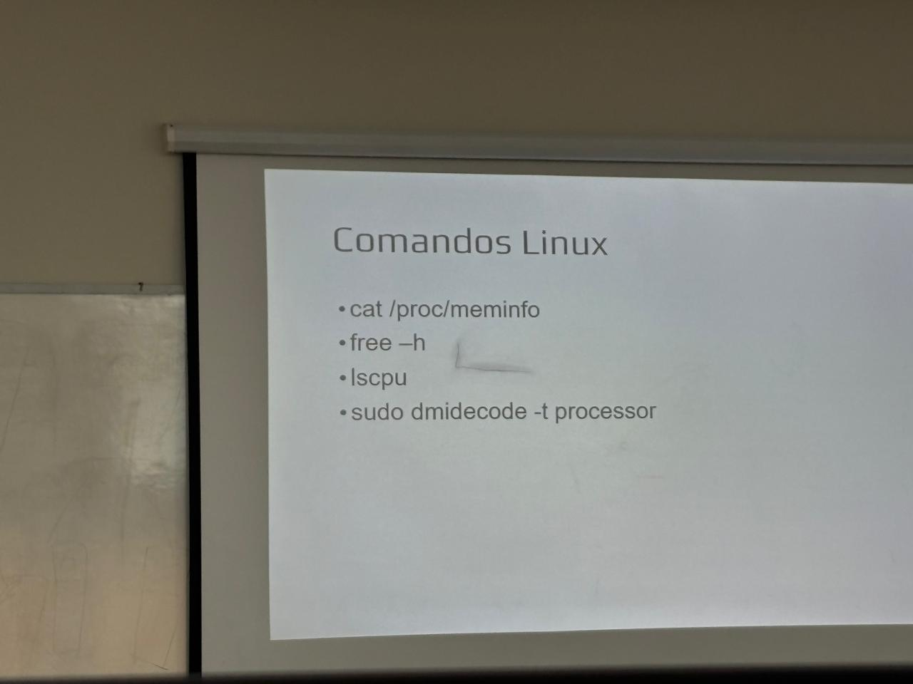
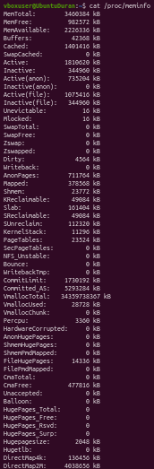
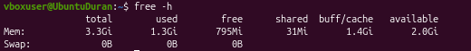
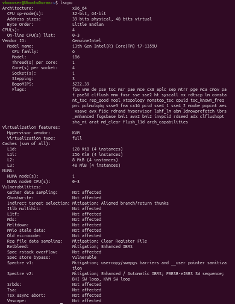
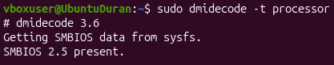

# Práctica: Diagnóstico de Memoria y CPU en Linux

Actividad práctica para la inspección y diagnóstico de hardware en un entorno **Linux (Ubuntu)**, enfocada en la jerarquía de memoria física/virtual y las especificaciones arquitectónicas del procesador.

---

## Instrucciones Asignadas

  

### Comandos a Ejecutar:
1. `cat /proc/meminfo` — Diagnóstico detallado del subsistema de memoria virtual y física desde el sistema de archivos procfs.
2. `free -h` — Resumen legible para humanos del uso actual de memoria RAM y espacio de intercambio (Swap).
3. `lscpu` — Arquitectura, núcleos, sockets, frecuencias de reloj y jerarquía de memoria caché de la CPU.
4. `sudo dmidecode -t processor` — Volcado e inspección de las tablas SMBIOS/DMI para obtener datos físicos del procesador a nivel de hardware.

---

## 1. Memoria — `cat /proc/meminfo`

### Captura de Terminal

  

### Análisis y Métricas Principales
- **MemTotal:** Memoria física utilizable por el sistema operativo (excluyendo código y estructuras reservadas del kernel).
- **MemFree:** Cantidad de memoria física completamente libre sin ningún uso.
- **MemAvailable:** Estimación de memoria disponible para iniciar nuevas aplicaciones sin necesidad de usar Swap.
- **Buffers / Cached:** Memoria utilizada para almacenamiento en búfer de bloques y caché de páginas del sistema de archivos.
- **SwapTotal / SwapFree:** Capacidad y disponibilidad del espacio de intercambio en disco.

---

## 2. Memoria — `free -h`

### Captura de Terminal

  

### Análisis y Métricas Principales
- **total:** Cantidad total de memoria física instalada y visible (`3.3Gi`).
- **used:** Memoria actualmente en uso por procesos del sistema (`1.3Gi`).
- **free:** Memoria no asignada y ociosa (`795Mi`).
- **shared:** Memoria compartida utilizada principalmente por `tmpfs` (`31Mi`).
- **buff/cache:** Memoria asignada dinámicamente para buffers y caché de E/S (`1.4Gi`).
- **available:** Memoria estimada disponible para asignación inmediata (`2.0Gi`).
- **Swap:** 0B asignados/utilizados en la máquina virtual.

---

## 3. Procesador — `lscpu`

### Captura de Terminal

  

### Análisis y Métricas Principales
- **Architecture:** Juego de instrucciones `x86_64`.
- **CPU(s):** 4 CPUs lógicas visibles para el sistema operativo.
- **Model name:** `13th Gen Intel(R) Core(TM) i7-1355U`.
- **Thread(s) per core / Core(s) per socket:** 1 hilo por núcleo, 4 núcleos por socket virtual.
- **Virtualization:** Hipervisor KVM / VirtualBox activo.
- **Caches:**
  - **L1d:** 128 KiB (4 instancias de 32 KiB).
  - **L1i:** 256 KiB (4 instancias de 64 KiB).
  - **L2:** 8 MiB (4 instancias de 2 MiB).
  - **L3:** 48 MiB (4 instancias de 12 MiB).

---

## 4. Procesador — `sudo dmidecode -t processor`

### Captura de Terminal

  

### Análisis y Métricas Principales
- **SMBIOS Version:** `SMBIOS 2.5 present` obtenido a través de `sysfs`.
- **Nivel de virtualización:** En entornos virtualizados bajo VirtualBox con tablas DMI restringidas o sintéticas, la herramienta lee la especificación SMBIOS emulada del hipervisor.
