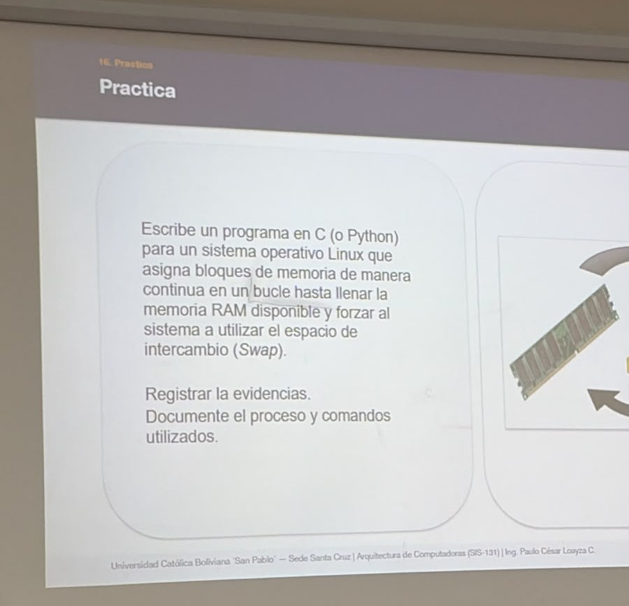

# Práctica: Saturación de Memoria RAM y Activación del Espacio de Intercambio (Swap) en Linux

### Análisis Experimental de Paginación por Demanda (*Demand Paging*), Desalojo de Marcos (*Page Swapping*) y Gestión de Memoria Virtual en Linux

---

## 1. Información Académica

| Campo | Detalle |
|---|---|
| **Universidad** | Universidad Católica Boliviana "San Pablo" — Sede Santa Cruz |
| **Departamento** | Departamento de Ingenierías y Ciencias Exactas |
| **Carrera** | Ingeniería en Inteligencia Artificial / Ingeniería de Software |
| **Materia** | Arquitectura de Computadoras (SIS-131) |
| **Docente** | Ing. Paulo César Loayza Carrasco |
| **Estudiante** | Leonardo Durán Cuenca |
| **Semestre** | 4to Semestre — 2/2026 |
| **Entorno** | Ubuntu Linux (Máquina Virtual / WSL2 / POSIX) |
| **Archivos** | [`saturacion_swap.c`](saturacion_swap.c) \| [`saturacion_swap.py`](saturacion_swap.py) |

---

## 2. Consigna Asignada

<p align="center">
  
</p>

> **Texto de la Consigna:**  
> *"Escribe un programa en C (o Python) para un sistema operativo Linux que asigna bloques de memoria de manera continua en un bucle hasta llenar la memoria RAM disponible y forzar al sistema a utilizar el espacio de intercambio (Swap).*  
> *Registrar las evidencias. Documente el proceso y comandos utilizados."*

---

## 3. Fundamentos Arquitectónicos y del Sistema Operativo

### 3.1. Memoria Virtual y Paginación por Demanda (*Demand Paging*)
En los sistemas operativos modernos con arquitectura x86-64:
* Los procesos no interactúan directamente con las direcciones físicas de los módulos de memoria RAM (*DRAM*), sino con un **espacio de direcciones virtuales**.
* La unidad mínima de mapeo entre memoria virtual y memoria física es la **página** (típicamente **$4096\text{ bytes} = 4\text{ KiB}$**).
* Linux utiliza **asignación perezosa u optimista (*Optimistic Overcommit*)**: cuando un programa invoca `malloc(tamano)`, el kernel únicamente reserva un rango de direcciones en el espacio virtual del proceso sin asignar marcos físicos reales (*Page Frames*).
* Solo cuando la CPU ejecuta una instrucción de lectura o escritura en dicha dirección, la Unidad de Manejo de Memoria (**MMU**) detecta que la página no está presente en la RAM física y genera una interrupción de hardware conocida como **Fallo de Página (*Page Fault*)**. En ese instante, el kernel busca un marco libre en RAM y actualiza la tabla de páginas (*Page Table*).

### 3.2. Espacio de Intercambio (*Swap*) y Desalojo de Páginas (*Paging Out*)
* Cuando el programa continúa solicitando y escribiendo memoria de manera continua, los marcos físicos libres de la memoria RAM se agotan (`MemAvailable` tiende a 0).
* Para evitar un colapso inmediato, el Administrador de Memoria Virtual del kernel activa el **subsistema de Swapping**:
  1. Identifica páginas de memoria anónimas o inactivas que no han sido accedidas recientemente (algoritmo LRU / reloj).
  2. Escribe el contenido de esas páginas en el disco secundario (en la partición o archivo de intercambio **Swap**).
  3. Desmarca el bit de presencia en la tabla de páginas, liberando el marco de RAM física para alojar las nuevas solicitudes del programa activo.

### 3.3. Monitoreo del Tráfico de Swap: `si` y `so`
A través de herramientas como `vmstat`, es posible monitorear directamente el flujo de páginas entre la RAM y el disco:
* **`so` (*Swap-Out*):** Cantidad de memoria transferida por segundo desde la memoria RAM física hacia el espacio Swap.
* **`si` (*Swap-In*):** Cantidad de memoria leída por segundo desde el Swap de vuelta a la RAM.

---

## 4. Implementación del Software

Para ofrecer total versatilidad y rigor académico, se implementaron soluciones tanto en **C (bajo nivel)** como en **Python (alto nivel)**:

### 4.1. Código en C: [`saturacion_swap.c`](saturacion_swap.c)
* **Asignación en bloques controlados:** Asigna bloques continuos de **$50\text{ MB}$** en un bucle infinito.
* **Escritura forzada en cada página (4096 bytes):** Para anular el *overcommit* perezoso del kernel de Linux, escribe datos a lo largo de cada límite de página, forzando un fallo de página físico en cada una de ellas:
  ```c
  for (size_t offset = 0; offset < CHUNK_SIZE_BYTES; offset += PAGE_SIZE_BYTES) {
      block[offset] = (char)(iteration & 0xFF);
  }
  ```
* **Retención de referencias:** Almacena los punteros en una lista enlazada dinámica para que la memoria permanezca ocupada y el sistema no la recolecte.
* **Manejo seguro de interrupciones:** Captura la señal `SIGINT` (Ctrl+C) para pausar la asignación y liberar ordenadamente todos los recursos mediante `free()`.

### 4.2. Código en Python: [`saturacion_swap.py`](saturacion_swap.py)
* Utiliza objetos `bytearray(50 * 1024 * 1024)` retenidos en una lista global. Al instanciar un `bytearray`, la máquina virtual de Python inicializa los bytes a cero, lo cual dispara la asignación física inmediata de marcos en la memoria del kernel.

---

## 5. Guía de Ejecución y Comandos de Monitoreo

### Paso 1: Verificar el Estado Inicial de la Memoria y Swap
Antes de ejecutar la prueba, compruebe en una terminal que el sistema tiene una partición o archivo Swap configurado y activo:

```bash
# 1. Comprobar si existe espacio Swap activo
swapon --show

# 2. Inspeccionar la memoria inicial
free -h
```

*Nota:* Si `swapon --show` no muestra ninguna línea o `free -h` muestra `Swap: 0B`, se puede crear un archivo Swap temporal de 2 GB en Ubuntu con:
```bash
sudo fallocate -l 2G /swapfile
sudo chmod 600 /swapfile
sudo mkswap /swapfile
sudo swapon /swapfile
```

---

### Paso 2: Abrir una Terminal de Monitoreo en Tiempo Real
En una terminal separada, inicie uno de los siguientes comandos para observar el comportamiento dinámico de la RAM y el Swap:

```bash
# Opción A (Recomendada): Monitoreo continuo de free cada 1 segundo
watch -n 1 free -h

# Opción B: Inspección de I/O de Swap (columnas si y so) cada segundo
vmstat 1

# Opción C: Monitor interactivo de procesos
htop
```

---

### Paso 3: Compilar y Ejecutar el Programa en C (o Python)

En la terminal principal:

```bash
# Navegar a la carpeta de la práctica
cd PracticaMemoriaRamSwap

# Compilar el programa en C
gcc -O2 saturacion_swap.c -o saturacion_swap

# Ejecutar el programa (parámetro opcional: retardo en ms entre bloques, por defecto 100 ms)
./saturacion_swap 100
```

*Alternativa en Python:*
```bash
python3 saturacion_swap.py 100
```

---

## 6. Registro de Evidencias

A continuación se registran las capturas de pantalla que demuestran la evolución de la memoria hasta la activación efectiva del espacio Swap:

### 6.1. Evidencia 1 — Estado Inicial del Sistema (`free -h` y `swapon`)
*(Muestra la memoria RAM disponible antes de iniciar la saturación y la presencia de la partición/archivo Swap).*

<p align="center">
  
</p>

---

### 6.2. Evidencia 2 — Proceso de Asignación Continua en Terminal
*(Muestra el avance de las iteraciones del programa asignando bloques continuos de 50 MB).*

<p align="center">
  
</p>

---

### 6.3. Evidencia 3 — RAM Agotada y Activación del Espacio Swap
*(Muestra la terminal de monitoreo `watch -n 1 free -h` o `vmstat 1` donde el campo `used` de Swap comienza a subir por encima de 0B).*

<p align="center">
  
</p>

---

### 6.4. Evidencia 4 — Finalización Controlada y Liberación de Memoria
*(Muestra la parada con Ctrl+C, la liberación de los bloques y el retorno de la memoria RAM al sistema operativo).*

<p align="center">
  
</p>

---

## 7. Conclusiones y Análisis Arquitectónico

1. **La reserva virtual no equivale a consumo físico:** En Linux, la llamada `malloc()` no decrementa la memoria libre reportada por el kernel a menos que el programa escriba físicamente en las páginas, activando los mecanismos de *Demand Paging* y las interrupciones de *Page Fault*.
2. **El papel protector del Swap:** El espacio de intercambio actúa como un amortiguador crítico de seguridad. Cuando la memoria física de trabajo se satura, el sistema operativo evita un bloqueo catastrófico del kernel (*kernel panic*) o la invocación indiscriminada del *Out-Of-Memory Killer* (OOM Killer), transfiriendo páginas frías al almacenamiento secundario a costa de una mayor latencia de acceso.
3. **Control y liberación de recursos:** La estructura dinámica enlazada implementada garantiza que el usuario pueda interrumpir la prueba en cualquier instante mediante señales del sistema operativo (`SIGINT`), devolviendo la totalidad de los marcos de memoria física y virtual al sistema operativo sin dejar fugas (*memory leaks*).
