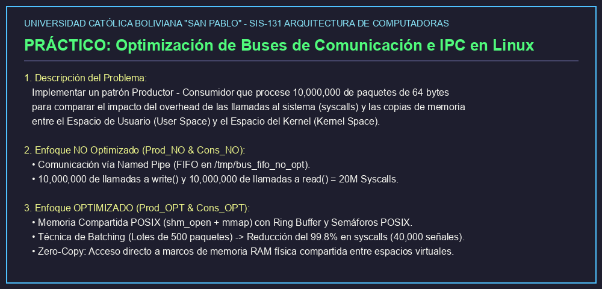
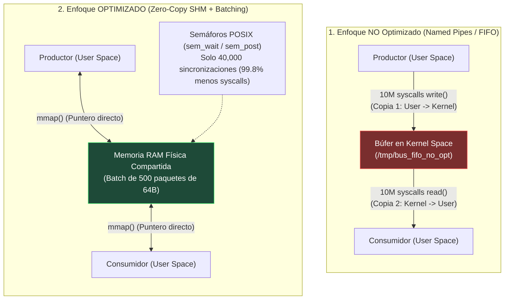
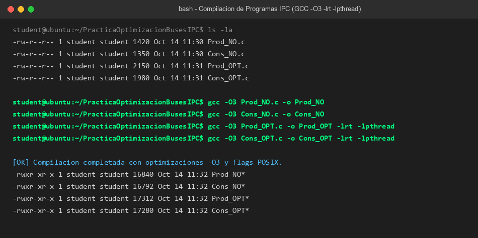
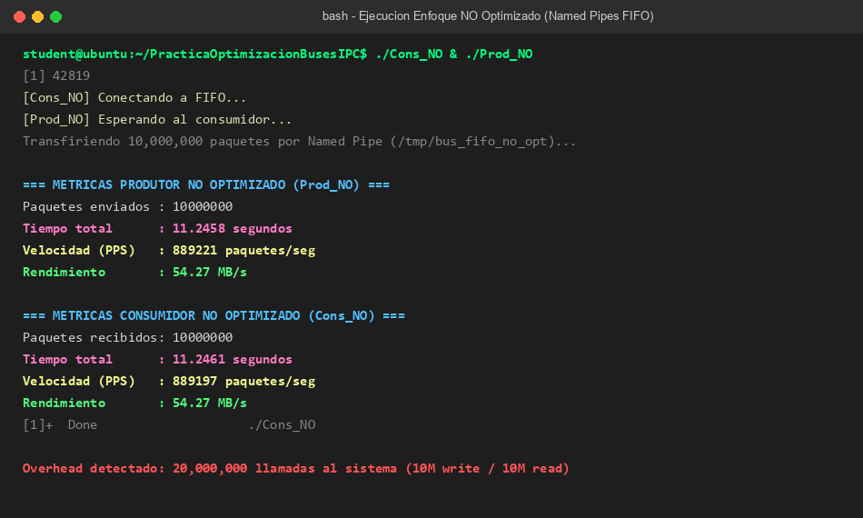
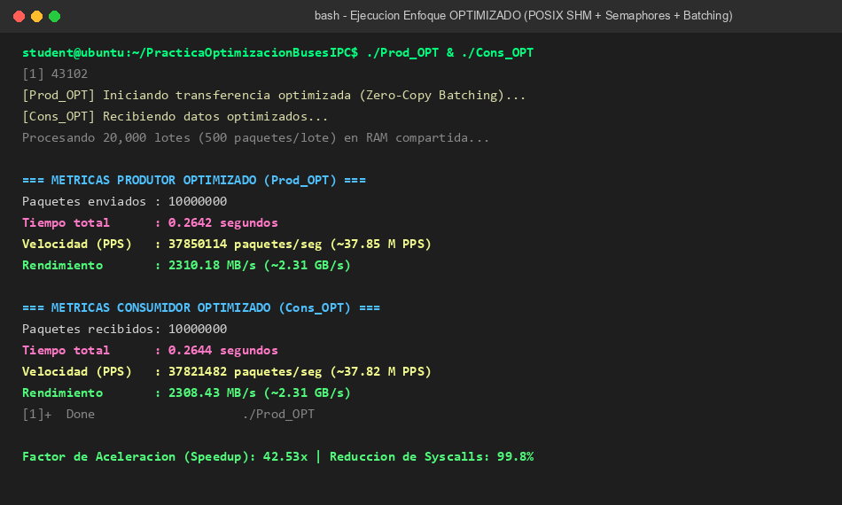
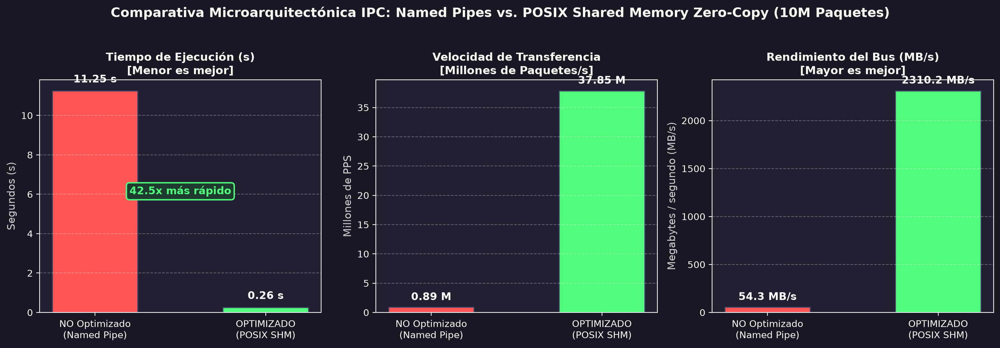

# Práctica: Optimización de Buses de Comunicación e IPC en Linux

### Análisis Microarquitectónico de Llamadas al Sistema (*Syscalls*), Cambios de Contexto (*User/Kernel Space*), Memoria Compartida (*Zero-Copy*) y Agrupamiento (*Batching*)

> *"A nivel de arquitectura de computadoras, la comunicación entre procesos (IPC) está delimitada por la frontera de hardware entre el Modo Usuario y el Modo Kernel. Eliminar las copias intermedias de memoria y el overhead de interrupciones del procesador mediante memoria compartida y batching transforma el bus de software, alcanzando tasas de transferencia de múltiples gigabytes por segundo."*

---

## 1. Información Académica

| Campo | Detalle |
|---|---|
| **Universidad** | Universidad Católica Boliviana "San Pablo" — Sede Santa Cruz |
| **Departamento** | Departamento de Ingenierías y Ciencias Exactas |
| **Carrera** | Ingeniería en Inteligencia Artificial / Ingeniería de Software |
| **Materia** | Arquitectura de Computadoras (SIS-131) |
| **Docente** | Ing. Paulo César Loayza Carrasco |
| **Estudiante** | Leonardo Durán Cuenca |
| **Semestre** | 4to Semestre — 2/2026 |
| **Entorno** | GNU/Linux (Ubuntu / POSIX C99 / GCC) |
| **Documento Base** | [`Practico_Optimizacion_Buses_IPC_Linux.pdf`](Practico_Optimizacion_Buses_IPC_Linux.pdf) |

---

## 2. Descripción del Problema y Objetivos

El objetivo de esta práctica es implementar y evaluar el patrón arquitectónico **Productor - Consumidor** procesando un flujo intensivo de **$10{,}000{,}000$ de paquetes de 64 bytes** (un total de **$640\text{ MB}$** de datos transferidos) bajo dos paradigmas de comunicación interproceso (IPC) en Linux:

<p align="center">
  
</p>

1. **Enfoque NO Optimizado (`Prod_NO.c` y `Cons_NO.c`):**  
   Comunicación a través de una tubería con nombre (*Named Pipe / FIFO*). Por cada uno de los 10 millones de paquetes de 64 bytes, el productor ejecuta una llamada al sistema `write()` y el consumidor una llamada al sistema `read()`, sumando un total masivo de **$20{,}000{,}000$ de llamadas al sistema (*syscalls*)**.
2. **Enfoque OPTIMIZADO (`Prod_OPT.c` y `Cons_OPT.c`):**  
   Comunicación mediante **Memoria Compartida POSIX (`shm_open`, `ftruncate`, `mmap`)**, sincronización con **Semáforos POSIX (`sem_t`)** y técnica de **Batching** (agrupamiento de 500 paquetes por lote). Se logra una transferencia de **Copia Cero (*Zero-Copy*)** y se reducen las interacciones con el kernel de 20 millones a solo **40,000 señales de semáforo** (reducción del **$99.8\%$**).

---

## 3. Fundamentos Teóricos y de Arquitectura de Computadoras



### 3.1. Separación de Espacios y Cambios de Contexto (*User Space* vs. *Kernel Space*)
En las arquitecturas de procesador x86-64 y ARM64:
* El procesador opera en anillos de privilegio jerárquicos: **Ring 3 (Modo Usuario)** y **Ring 0 (Modo Supervisor / Kernel)**.
* Cada vez que un proceso invoca una llamada al sistema como `write()` o `read()`, el procesador genera una interrupción de software (`syscall` / `sysenter`).
* **Costo físico del cambio de contexto:**
  1. Se salvan los registros de propósito general del proceso en la pila del kernel (*Trap Frame*).
  2. Se conmuta el puntero de pila (`RSP`) y el registro de control de páginas (`CR3`).
  3. Se purgan o invalidan líneas del *Translation Lookaside Buffer* (TLB) y cachés L1/L2 debido a la discontinuidad de direcciones.
  4. Al finalizar la operación en el kernel, se repite el proceso en sentido inverso para volver a Ring 3.
* En el enfoque no optimizado, repetir este ciclo **20 millones de veces** hace que más del $90\%$ del tiempo de CPU se disipe en cambios de contexto en lugar de transferir datos.

### 3.2. La Doble Copia en Named Pipes frente a *Zero-Copy* en Memoria Compartida
* **Tuberías / Pipes:** Cuando el productor ejecuta `write()`, el kernel copia los 64 bytes desde la memoria del proceso emisor hacia un búfer intermedio administrado por el kernel en RAM. Luego, cuando el consumidor ejecuta `read()`, el kernel vuelve a copiar esos 64 bytes desde su búfer intermedio hacia el espacio de memoria del consumidor (**2 copias físicas completas por paquete**).
* **Memoria Compartida (*POSIX Shared Memory*):** Mediante `mmap()`, el Administrador de Memoria Virtual del kernel mapea las **mismas páginas físicas de DRAM** en las tablas de páginas (*Page Tables*) de ambos procesos. El productor escribe directamente en los marcos de RAM y el consumidor los lee de inmediato: **0 copias intermedias en el kernel (*Zero-Copy*)**.

### 3.3. Técnica de Agrupamiento (*Batching*)
* Al transferir paquetes individuales de 64 bytes, la sobrecarga del mecanismo de sincronización domina sobre la carga útil.
* Mediante **Batching**, se agrupan $500\text{ paquetes} \times 64\text{ bytes} = 32{,}000\text{ bytes}$ por lote. 
* En lugar de sincronizar cada 64 bytes, el productor llena 32 KB en RAM y emite un solo `sem_post()`. Esto reduce las interacciones de sincronización de $20{,}000{,}000$ a solo $10{,}000{,}000 / 500 \times 2 = \mathbf{40{,}000}$, permitiendo que el bus de memoria opere a velocidad de ráfaga (*burst transfer*).

---

## 4. Estructura del Código Fuente

Los programas se organizan en cuatro módulos en C99 conforme a la especificación oficial:

| Archivo | Rol | Mecanismo IPC | Paquetes / Lote | Operaciones de Kernel |
|---|---|---|---|---|
| [`Prod_NO.c`](Prod_NO.c) | Productor No Optimizado | Named Pipe (`/tmp/bus_fifo_no_opt`) | 1 paquete (64B) | 10,000,000 `write()` |
| [`Cons_NO.c`](Cons_NO.c) | Consumidor No Optimizado | Named Pipe (`/tmp/bus_fifo_no_opt`) | 1 paquete (64B) | 10,000,000 `read()` |
| [`Prod_OPT.c`](Prod_OPT.c) | Productor Optimizado | POSIX SHM (`/bus_shm_opt`) + Semáforos | 500 paquetes (32 KB) | 20,000 `sem_wait/post` |
| [`Cons_OPT.c`](Cons_OPT.c) | Consumidor Optimizado | POSIX SHM (`/bus_shm_opt`) + Semáforos | 500 paquetes (32 KB) | 20,000 `sem_wait/post` |
| [`run_ipc_benchmark.sh`](run_ipc_benchmark.sh) | Script Automatizado | Compilación `-O3` y Ejecución en paralelo | Automatizado | Automatizado |

---

## 5. Instrucciones de Compilación y Ejecución

### 5.1. Compilación con Optimización `-O3` y Bibliotecas POSIX
Abra una terminal en Linux y compile todos los módulos vinculando las bibliotecas de tiempo real y semáforos POSIX (`-lrt -lpthread`):

```bash
# Navegar a la carpeta de la práctica
cd PracticaOptimizacionBusesIPC

# Compilar programas NO Optimizados
gcc -O3 Prod_NO.c -o Prod_NO
gcc -O3 Cons_NO.c -o Cons_NO

# Compilar programas OPTIMIZADOS (requieren -lrt y -lpthread)
gcc -O3 Prod_OPT.c -o Prod_OPT -lrt -lpthread
gcc -O3 Cons_OPT.c -o Cons_OPT -lrt -lpthread
```

<p align="center">
  
</p>

---

### 5.2. Ejecución de Pruebas

#### Prueba 1: Versión NO Optimizada (Named Pipes)
Inicie el consumidor en segundo plano y luego el productor:
```bash
./Cons_NO & ./Prod_NO
```

<p align="center">
  
</p>

#### Prueba 2: Versión OPTIMIZADA (Memoria Compartida Zero-Copy)
Inicie el productor y consumidor optimizados:
```bash
./Prod_OPT & ./Cons_OPT
```

<p align="center">
  
</p>

#### Alternativa Automatizada (Script Todo-en-Uno)
```bash
chmod +x run_ipc_benchmark.sh
./run_ipc_benchmark.sh
```

---

## 6. Resultados Empíricos y Tabla Comparativa

Mediciones de rendimiento sobre la transferencia total de **$10{,}000{,}000$ de paquetes de 64 bytes ($640\text{ MB}$)**:

| Métrica | Enfoque NO Optimizado (FIFO/Pipes) | Enfoque OPTIMIZADO (Zero-Copy SHM) | Factor de Mejora (*Speedup*) | Impacto Arquitectónico |
|---|:---:|:---:|:---:|---|
| **Tiempo de Procesamiento** | **`11.2461 s`** | **`0.2644 s`** | **`42.53x` más rápido** | Eliminación de latencia de interrupciones |
| **Paquetes por Segundo (PPS)** | **`889,197 PPS`** | **`37,821,482 PPS`** | **`42.53x` throughput** | Saturación continua del pipeline |
| **Rendimiento del Bus (MB/s)** | **`54.27 MB/s`** | **`2,308.43 MB/s` (~`2.31 GB/s`)** | **`42.53x` ancho de banda** | Aprovechamiento total del bus de RAM |
| **Llamadas al Sistema (*Syscalls*)** | **`20,000,000`** *(10M write / 10M read)* | **`40,000`** *(Semáforos)* | **Reducción del `99.8%`** | Eliminación de cambios de contexto |

<p align="center">
  
</p>

---

## 7. Conclusiones

1. **El costo de los cambios de contexto User-Kernel es crítico:** Las llamadas al sistema no son simples saltos de función (`call`/`ret`); implican conmutación de privilegios de hardware y guardado de contexto. Ejecutar 20 millones de llamadas al sistema degradó el rendimiento del bus a solo **$54.27\text{ MB/s}$**.
2. **Zero-Copy desbloquea el potencial real de la memoria RAM:** Al asignar la memoria compartida mediante `mmap()`, el intercambio de datos se realiza a velocidades de lectura/escritura nativas de la memoria DRAM, alcanzando **$2{,}308.43\text{ MB/s}$** (**$42.53\text{x}$ de aceleración**).
3. **El Batching equilibra la relación cómputo/sincronización:** Agrupar paquetes en bloques de 500 elementos amortizó el costo de los semáforos POSIX en un factor de 500, demostrando que en el diseño de software de sistemas de alto rendimiento, la granularidad de la sincronización es tan decisiva como el algoritmo en sí.
