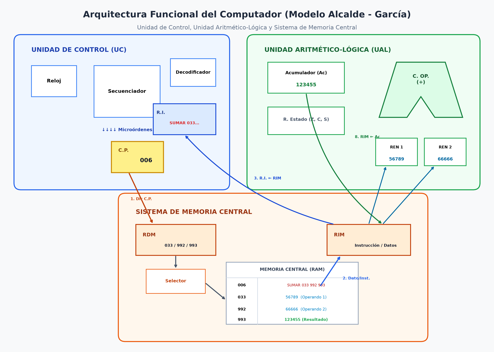
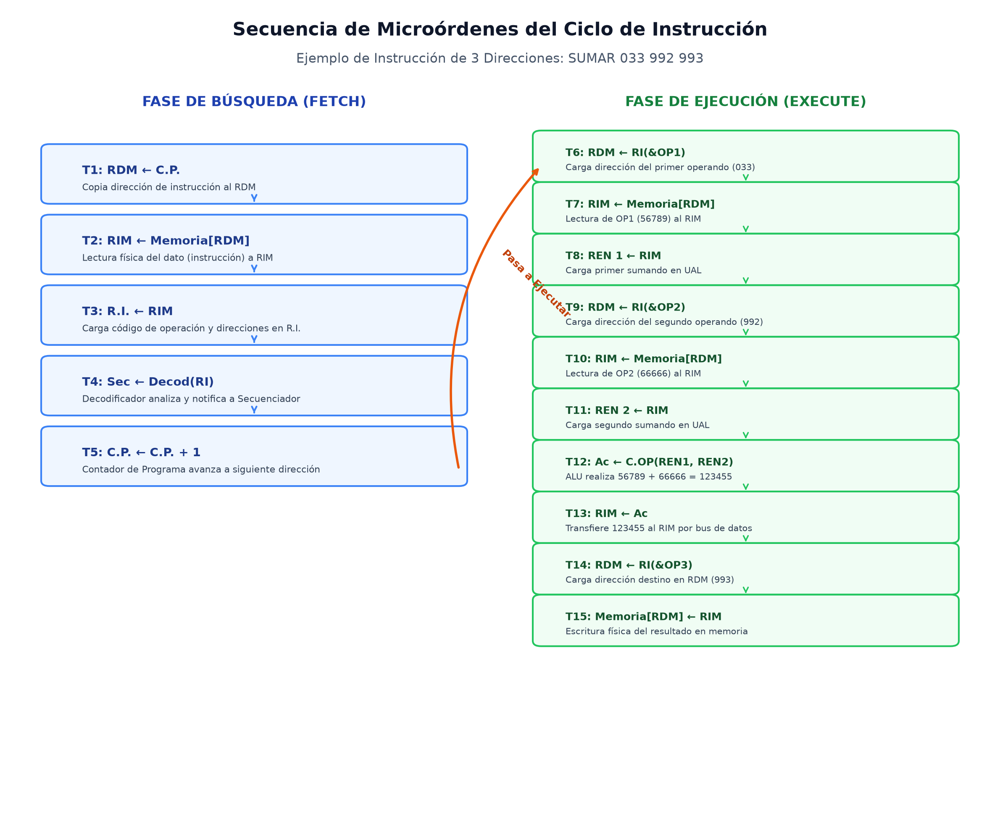
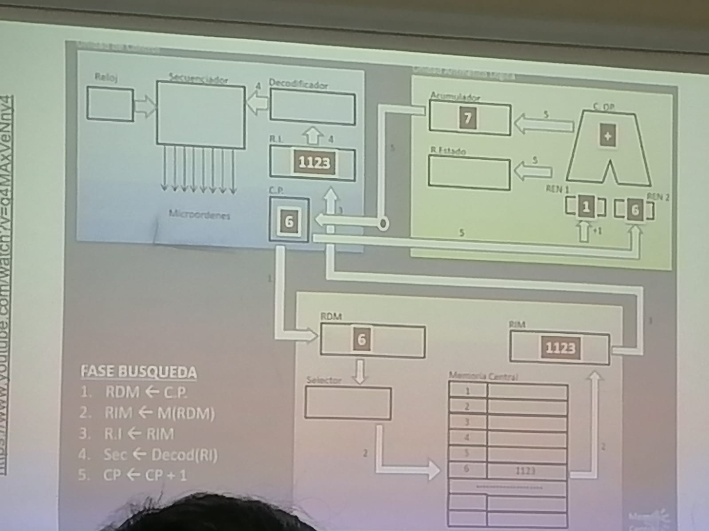

# Diseño Lógico y Arquitectura del Simulador de Computador en Microsoft Excel con VBA

**Universidad Católica Boliviana "San Pablo" — Sede Santa Cruz**  
**Carrera:** Ingeniería en Inteligencia Artificial  
**Materia:** Arquitectura de Computadoras  
**Semestre:** 4to Semestre — 2026  
**Docente:** Ing. Paulo César Loayza Carrasco  
**Estudiante:** Leonardo Durán Cuenca  
**Fecha:** 9 de septiembre de 2026  
**Proyecto:** Primer Parcial — Simulación de Memoria, Registros y Ciclo de Instrucción  

---

## Tabla de Contenidos
1. [Introducción y Objetivos de la Tarea 1](#1-introducción-y-objetivos-de-la-tarea-1)
2. [Modelo Arquitectónico de Referencia: Alcalde & García López](#2-modelo-arquitectónico-de-referencia-alcalde--garcía-lópez)
   - 2.1 Unidad de Control (UC)
   - 2.2 Unidad Aritmético-Lógica (UAL)
   - 2.3 Sistema de Memoria Central (RAM)
   - 2.4 Estructura de Buses del Sistema
3. [Formato de Instrucción de Tres Direcciones](#3-formato-de-instrucción-de-tres-direcciones)
4. [Desglose Riguroso de Microórdenes en Notación RTL](#4-desglose-riguroso-de-microórdenes-en-notación-rtl)
   - 4.1 Fase de Búsqueda (Fetch): Microórdenes 1 a 5
   - 4.2 Fase de Ejecución (Execute): Microórdenes 6 a 15
5. [Diagramas de Arquitectura y Flujo de Control](#5-diagramas-de-arquitectura-y-flujo-de-control)
6. [Diseño Lógico y Mapeo en Microsoft Excel con VBA](#6-diseño-lógico-y-mapeo-en-microsoft-excel-con-vba)
   - 6.1 Estructura de la Hoja `Simulador_CPU`
   - 6.2 Estructura de la Hoja `Tabla_de_Traza`
   - 6.3 Automatización e Interactividad con Visual Basic for Applications (VBA)
   - 6.4 Botones Gráficos Flotantes y Animación de Formas (`Shapes`)
7. [Planificación General del Primer Parcial (5 Tareas Modulares)](#7-planificación-general-del-primer-parcial-5-tareas-modulares)
8. [Bibliografía y Referencias](#8-bibliografía-y-referencias)

---

## 1. Introducción y Objetivos de la Tarea 1

El presente proyecto para el **Primer Parcial** tiene como finalidad diseñar e implementar un simulador funcional, visual e interactivo de la arquitectura básica de un computador digital utilizando **Microsoft Excel** y su motor nativo de programación **Visual Basic for Applications (VBA)**.

El modelo adoptado emula de manera transparente el ciclo de instrucción de la máquina de Von Neumann según el marco pedagógico presentado en el texto clásico de informática de **Eduardo Alcalde Lancharro y Miguel García López (McGraw-Hill)**, correspondiente al material de clase proyectado por el docente.

### Objetivos Específicos de la Tarea 1:
* Formalizar la arquitectura lógica de bloques funcionales (UC, UAL, Memoria) y sus registros.
* Definir la secuencia exacta de microórdenes en notación RTL (*Register Transfer Level*) para la instrucción modelo de tres direcciones: `SUMAR 033 992 993`.
* Generar los diagramas arquitectónicos y de flujo mediante scripts de Python para su documentación e integración visual.
* Proveer el libro de trabajo maquetado (`SimuladorMemoriaCPU.xlsx`) y el módulo exportable de macros (`ModuloSimuladorCPU.bas`).
* Establecer el plan de desglose en 5 tareas secuenciales para el desarrollo y defensa del parcial en Excel.

---

## 2. Modelo Arquitectónico de Referencia: Alcalde & García López

El modelo propuesto divide al computador en tres grandes bloques interconectados mediante buses de control, direcciones y datos:

```
┌─────────────────────────────────────────────────────────────────────────────────────────────┐
│                               UNIDAD CENTRAL DE PROCESO (CPU)                               │
│                                                                                             │
│  ┌───────────────────────────────────────┐   ┌───────────────────────────────────────────┐  │
│  │       UNIDAD DE CONTROL (UC)          │   │      UNIDAD ARITMÉTICO-LÓGICA (UAL)       │  │
│  │                                       │   │                                           │  │
│  │  • Reloj (Pulsos periódicos)          │   │  • Circuito Operacional (C.OP): Sumador   │  │
│  │  • Secuenciador (Genera microórdenes) │   │  • Acumulador (Ac): Almacena resultados   │  │
│  │  • Decodificador de Instrucción       │   │  • Registro de Estado (Flags: Z, C, S)    │  │
│  │  • R.I. (Registro de Instrucción)     │   │  • REN 1: Registro Entrada 1 (Operando 1) │  │
│  │  • C.P. (Contador de Programa / PC)   │   │  • REN 2: Registro Entrada 2 (Operando 2) │  │
│  └───────────────────┬───────────────────┘   └─────────────────────┬─────────────────────┘  │
└──────────────────────┼─────────────────────────────────────────────┼────────────────────────┘
                       │                  Buses del Sistema          │
                       │     Bus de Direcciones (C.P. / R.I. -> RDM) │
                       │     Bus de Datos (RIM <-> UAL / RAM)        │
                       ▼                                             ▼
┌─────────────────────────────────────────────────────────────────────────────────────────────┐
│                                 SISTEMA DE MEMORIA CENTRAL                                  │
│                                                                                             │
│  • RDM (Registro de Dirección de Memoria): Recibe la dirección física a consultar.          │
│  • Selector de Memoria: Circuito decodificador de direcciones que habilita la celda física. │
│  • Memoria Central (RAM): Arreglo secuencial de celdas direccionables (1 a N).              │
│  • RIM (Registro de Información de Memoria / Intercambio): Buffer bidireccional de datos.   │
└─────────────────────────────────────────────────────────────────────────────────────────────┘
```

### 2.1 Unidad de Control (UC)
* **Reloj:** Oscilador que suministra una señal cuadrada periódica para sincronizar las operaciones de todos los circuitos biestables.
* **Secuenciador:** Generador microprogramado o cableado que, en cada pulso de reloj, emite las señales lógicas de control (**microórdenes**) hacia las compuertas de los registros y buses.
* **Decodificador:** Circuito combinacional que analiza el campo del código de operación del `R.I.` e indica al secuenciador cuál es la instrucción en curso.
* **Registro de Instrucción (`R.I.`):** Almacena la instrucción binaria o textual leída de la memoria principal durante la fase de búsqueda.
* **Contador de Programa (`C.P.` o `PC`):** Registro que guarda la dirección de memoria de la **siguiente instrucción** a ser procesada.

### 2.2 Unidad Aritmético-Lógica (UAL)
* **Circuito Operacional (`C.OP.`):** Red de compuertas aritméticas y lógicas capaz de realizar operaciones elementales (en el ejemplo didáctico: suma binaria/decimal).
* **Acumulador (`Ac`):** Registro de retención rápida que almacena el resultado temporal o definitivo generado por el `C.OP.`.
* **Registro de Estado (`R.Estado` / Flags):** Flip-flops que reflejan propiedades del último cálculo:
  * `Z` (*Zero Flag*): Vale 1 si el resultado es igual a cero.
  * `C` (*Carry Flag*): Vale 1 si se produjo acarreo en la operación.
  * `S` (*Sign Flag*): Vale 1 si el resultado es negativo.
* **Registros de Entrada (`REN 1` y `REN 2`):** Registros buffers temporales que sostienen de forma estable los dos operandos en las entradas del sumador mientras se estabiliza el circuito lógico.

### 2.3 Sistema de Memoria Central (RAM)
* **`RDM` (Registro de Dirección de Memoria):** Conectado al bus de direcciones. Guarda la dirección donde se desea leer o escribir.
* **`Selector de Memoria`:** Actúa como un decodificador de $n$ entradas a $2^n$ salidas que selecciona físicamente la línea de la palabra de memoria correspondiente al valor presente en el `RDM`.
* **`RIM` (Registro de Información de Memoria / Intercambio):** Conectado al bus de datos. Recibe la palabra leída de la memoria central en un ciclo de lectura, o almacena la palabra que será escrita en memoria en un ciclo de escritura.

---

## 3. Formato de Instrucción de Tres Direcciones

El caso de estudio propuesto por el docente corresponde a una **arquitectura de 3 direcciones**:

$$\mathbf{SUMAR \quad 033 \quad 992 \quad 993}$$

* **Código de Operación (CO):** `SUMAR` (identificador de la operación que la UAL debe realizar).
* **Dirección del Primer Operando (&OP1):** `033` (posición de memoria que alberga el primer sumando: `56789`).
* **Dirección del Segundo Operando (&OP2):** `992` (posición de memoria que alberga el segundo sumando: `66666`).
* **Dirección del Resultado / Destino (&OP3):** `993` (posición de memoria donde se almacenará el resultado final: `123455`).

En este formato explícito, la CPU no asume ningún operando implícito en el acumulador antes de iniciar la instrucción, lo que permite observar con total transparencia el tráfico en el bus tanto de lectura de operandos como de escritura del resultado.

---

## 4. Desglose Riguroso de Microórdenes en Notación RTL

El ciclo de instrucción se ejecuta en **15 microórdenes discretas** (5 en la fase de búsqueda y 10 en la fase de ejecución):

```
┌─────────────────────────────────────────────────────────────────────────────────────────────┐
│                                   CICLO DE INSTRUCCIÓN                                      │
├───────────────────────────────────────────────┬─────────────────────────────────────────────┤
│            FASE DE BÚSQUEDA (FETCH)           │          FASE DE EJECUCIÓN (EXECUTE)        │
│  Paso T1 : RDM ← C.P.                         │  Paso T6 : RDM ← RI(&OP1)                   │
│  Paso T2 : RIM ← M(RDM)                       │  Paso T7 : RIM ← S(RDM)  [Dato 56789]       │
│  Paso T3 : R.I. ← RIM                         │  Paso T8 : REN 1 ← RIM                      │
│  Paso T4 : Sec ← Decod(RI)                    │  Paso T9 : RDM ← RI(&OP2)                   │
│  Paso T5 : C.P. ← C.P. + 1                    │  Paso T10: RIM ← S(RDM)  [Dato 66666]       │
│                                               │  Paso T11: REN 2 ← RIM                      │
│                                               │  Paso T12: Ac ← C.OP(REN1, REN2)            │
│                                               │  Paso T13: RIM ← Ac      [Dato 123455]      │
│                                               │  Paso T14: RDM ← RI(&OP3)                   │
│                                               │  Paso T15: M(RDM) ← RIM  [Graba en 993]     │
└───────────────────────────────────────────────┴─────────────────────────────────────────────┘
```

### 4.1 Fase de Búsqueda (Fetch): Microórdenes 1 a 5
1. **$T_1: \text{RDM} \leftarrow \text{C.P.}$**  
   La Unidad de Control activa la salida del Contador de Programa hacia el bus de direcciones y habilita la carga en el RDM. Si el `C.P.` contiene `006`, el `RDM` pasa a contener `006`.
2. **$T_2: \text{RIM} \leftarrow \text{M}(\text{RDM})$**  
   El selector de memoria decodifica la dirección `006` en la memoria central y activa la línea de lectura. La instrucción almacenada en dicha posición (`SUMAR 033 992 993`) viaja por el bus de datos hacia el RIM.
3. **$T_3: \text{R.I.} \leftarrow \text{RIM}$**  
   El contenido del RIM se transfiere al Registro de Instrucción (`R.I.`) de la Unidad de Control a través del bus interno de datos.
4. **$T_4: \text{Sec} \leftarrow \text{Decod}(\text{RI})$**  
   El decodificador analiza la instrucción presente en el `R.I.`. Reconoce el código de operación `SUMAR` y habilita en el secuenciador la rutina de microórdenes específica para suma con 3 direcciones.
5. **$T_5: \text{C.P.} \leftarrow \text{C.P.} + 1$**  
   El Contador de Programa se incrementa en una unidad, pasando de `006` a `007`, quedando preparado para la siguiente instrucción consecutiva.

### 4.2 Fase de Ejecución (Execute): Microórdenes 6 a 15
* **Captura del Primer Operando (OP1):**
  6. **$T_6: \text{RDM} \leftarrow \text{RI}(\&OP1)$:** Se extrae la dirección `033` del `R.I.` y se deposita en el `RDM`.
  7. **$T_7: \text{RIM} \leftarrow \text{Selector}(\text{RDM})$:** El selector lee la celda `033` de la RAM y deposita el dato `56789` en el `RIM`.
  8. **$T_8: \text{REN 1} \leftarrow \text{RIM}$:** El dato `56789` viaja desde el `RIM` al Registro de Entrada 1 (`REN 1`) de la UAL.
* **Captura del Segundo Operando (OP2):**
  9. **$T_9: \text{RDM} \leftarrow \text{RI}(\&OP2)$:** Se extrae la dirección `992` del `R.I.` y se deposita en el `RDM`.
  10. **$T_{10}: \text{RIM} \leftarrow \text{Selector}(\text{RDM})$:** El selector lee la celda `992` de la RAM y deposita el dato `66666` en el `RIM`.
  11. **$T_{11}: \text{REN 2} \leftarrow \text{RIM}$:** El dato `66666` viaja desde el `RIM` al Registro de Entrada 2 (`REN 2`) de la UAL.
* **Operación y Almacenamiento en Acumulador:**
  12. **$T_{12}: \text{Ac} \leftarrow \text{C.OP}(\text{REN 1}, \text{REN 2})$:** El secuenciador envía la microorden de cálculo a la UAL. Se efectúa la operación $56789 + 66666 = 123455$. El resultado se deposita en el `Acumulador` y se actualiza el `R.Estado` ($Z=0, C=0, S=0$).
* **Escritura del Resultado en Memoria (OP3):**
  13. **$T_{13}: \text{RIM} \leftarrow \text{Ac}$:** El valor `123455` del Acumulador viaja por el bus de datos hacia el `RIM`.
  14. **$T_{14}: \text{RDM} \leftarrow \text{RI}(\&OP3)$:** Se extrae la dirección de destino `993` del `R.I.` y se coloca en el `RDM`.
  15. **$T_{15}: \text{Memoria}[\text{RDM}] \leftarrow \text{RIM}$:** El selector ubica la celda `993` y la Unidad de Control emite la señal de escritura en el bus de control. El dato `123455` queda grabado permanentemente en la memoria central.

---

## 5. Diagramas de Arquitectura y Flujo de Control

A continuación se presentan los diagramas de arquitectura en alta resolución generados programáticamente con Python (`matplotlib`):

### Diagrama 1: Arquitectura Funcional del Computador (Modelo Alcalde - García)
Muestra la distribución espacial de los tres bloques (Unidad de Control en azul, UAL en verde, Memoria en naranja), sus registros internos y las rutas de los buses numeradas según el flujo temporal de las microórdenes:

<p align="center">
  
</p>

### Diagrama 2: Secuencia Cronológica de Microórdenes (Fetch y Execute)
Detalla la transición paso a paso desde el pulso de reloj $T_1$ hasta $T_{15}$:

<p align="center">
  
</p>

### Diagrama 3: Material Original de Referencia Proyectado en Aula
Registro fotográfico del diagrama expuesto por el docente durante la sesión teórica:

<p align="center">
  
</p>

---

## 6. Diseño Lógico y Mapeo en Microsoft Excel con VBA

Para materializar este modelo en Microsoft Excel, se ha estructurado el libro en dos hojas de trabajo complementadas por un módulo estándar de VBA:

### 6.1 Estructura de la Hoja `Simulador_CPU`
Representa el tablero de control del procesador. El espacio visual de celdas se distribuye de la siguiente manera:

* **Bloque Azul (Unidad de Control — Columnas B a D, Filas 4 a 11):**
  * Celda `C5`: Contador de Programa (`C.P.`) [Valor: `006`]
  * Celda `C6`: Registro de Instrucción (`R.I.`) [Valor: `SUMAR 033 992 993`]
  * Celda `C7`: Código de Operación (`CO`) [Valor: `SUMAR`]
  * Celdas `C8`, `C9`, `C10`: Direcciones de operandos (`033`, `992`, `993`)
  * Celda `C11`: Fase / Estado actual del procesador
* **Bloque Verde (Unidad Aritmético-Lógica — Columnas F a H, Filas 4 a 11):**
  * Celda `G5`: Registro de Entrada 1 (`REN 1`)
  * Celda `G6`: Registro de Entrada 2 (`REN 2`)
  * Celda `G7`: Circuito Operacional (`C.OP`) [Operación: `+`]
  * Celda `G8`: Acumulador (`Ac`)
  * Celdas `G9`, `G10`, `G11`: Banderas de estado (`Z`, `C`, `S`)
* **Bloque Naranja (Sistema de Memoria — Columnas J a K, Filas 4 a 11):**
  * Celda `K5`: Registro de Dirección de Memoria (`RDM`)
  * Celda `K6`: Registro de Información de Memoria (`RIM`)
  * Celda `K7`: Estado del Selector de Memoria
  * Celda `K11`: Paso de reloj actual (`T0` a `T15`)
* **Tabla de Memoria Central (RAM — Columnas B a F, Filas 13 a 20):**
  * Columna B: Dirección de memoria (`006`, `033`, `992`, `993`, etc.)
  * Columna C: Contenido de la celda
  * Columna D: Tipo de información (Instrucción o Dato)
  * Columna E: Observación / Descripción
  * Columna F: Puntero visual activo (Resaltado dinámico con `Interior.Color`)
* **Panel de Acciones y Consola (Columnas H a K, Filas 13 a 20):**
  * Botones flotantes interactivos de Formas (`Shapes`) con macros asignadas.
  * Celda `H18`: Consola explicativa que redacta en lenguaje natural la acción física ocurrida en el bus en cada pulso de reloj.

### 6.2 Estructura de la Hoja `Tabla_de_Traza`
Cada vez que se avanza un ciclo de reloj mediante el botón interactivo, el motor registra automáticamente una nueva fila en esta hoja, construyendo el historial completo:

| Paso ($T_n$) | Fase | Microorden (RTL) | C.P. | RDM | RIM | R.I. | REN 1 | REN 2 | Ac | Mem[993] | Descripción Operacional |
| :---: | :---: | :--- | :---: | :---: | :---: | :--- | :---: | :---: | :---: | :---: | :--- |
| **T0** | INICIAL | Estado previo al inicio | 006 | 000 | 0 | 0 | 0 | 0 | 0 | 0 | Estado en reposo |
| **T1** | BÚSQUEDA | $\text{RDM} \leftarrow \text{C.P.}$ | 006 | 006 | 0 | 0 | 0 | 0 | 0 | 0 | Bus direcciones activado |
| **T2** | BÚSQUEDA | $\text{RIM} \leftarrow \text{M}(\text{RDM})$ | 006 | 006 | SUMAR... | 0 | 0 | 0 | 0 | 0 | Lectura de instrucción |
| **...** | ... | ... | ... | ... | ... | ... | ... | ... | ... | ... | ... |
| **T12** | EJECUCIÓN | $\text{Ac} \leftarrow \text{C.OP}(\text{REN1}, \text{REN2})$ | 007 | 992 | 66666 | SUMAR... | 56789 | 66666 | **123455** | 0 | UAL realiza $56789 + 66666$ |
| **T15** | EJECUCIÓN | $\text{M}(\text{RDM}) \leftarrow \text{RIM}$ | 007 | 993 | 123455 | SUMAR... | 56789 | 66666 | 123455 | **123455** | Escritura en celda 993 |

### 6.3 Automatización e Interactividad con Visual Basic for Applications (VBA)
El motor de ejecución está escrito en **Visual Basic for Applications (VBA)** y contenido en:
[`PrimerParcialSimulacionMemoria/ModuloSimuladorCPU.bas`](ModuloSimuladorCPU.bas)

Dicho módulo implementa:
1. **`PasoCicloReloj()`:** Ejecuta una sola microorden por pulsación, actualizando los registros, coloreando dinámicamente las celdas activas con `Range.Interior.Color` y registrando el evento en `Tabla_de_Traza`.
2. **`EjecutarInstruccionCompleta()`:** Corre los 15 pasos de forma automatizada introduciendo pausas temporales (`Application.Wait`) y refrescos de pantalla (`DoEvents`) para visualizar el avance paso a paso como una animación.
3. **`ResetCPU()`:** Restablece todos los registros a su valor de inicio (`C.P. = 006`, `RDM = 000`, `Ac = 0`, etc.) y limpia los colores de memoria.

### 6.4 Botones Gráficos Flotantes y Animación de Formas (`Shapes`)
A diferencia de un entorno web limitado, **Microsoft Excel permite manipular directamente la colección `Shapes`**:
* La macro **`CrearBotonesInteractivos()`** dibuja formas rectangulares con esquinas redondeadas (`msoShapeRoundedRectangle`), colores vibrantes (Azul para Paso a Paso, Rojo para Reset, Verde para Ejecutar) y sombras 3D directamente sobre la cuadrícula.
* Mediante la propiedad `.OnAction`, cada botón queda enlazado de forma inmediata a su macro correspondiente sin necesidad de menús externos.

---

## 7. Planificación General del Primer Parcial (5 Tareas Modulares)

Para asegurar el éxito en la entrega y defensa del proyecto en Microsoft Excel, se establece el siguiente cronograma de 5 fases de trabajo:

| Tarea | Nombre de la Fase | Alcance Técnico | Entregables Principales |
| :---: | :--- | :--- | :--- |
| **Tarea 1** *(Completada)* | **Planificación, Arquitectura Lógica y Base Excel VBA** | Modelado formal del ciclo de instrucción, microórdenes, generación de diagramas en Python, creación del libro `.xlsx` y módulo `.bas`. | • Documento de diseño lógico.<br>• Diagramas generados con Python.<br>• Libro base `SimuladorMemoriaCPU.xlsx`.<br>• Módulo `ModuloSimuladorCPU.bas`. |
| **Tarea 2** | **Maquetación Visual y Botones con Formas en Excel** | Ajuste estético de la hoja en Excel con bordes, fuentes Consolas, botones flotantes `Shapes` y reglas de resaltado dinámico. | • Libro Excel con botones flotantes y paleta de colores. |
| **Tarea 3** | **Implementación de la Fase de Búsqueda (Fetch en VBA)** | Vinculación del botón `Paso a Paso` con la rutina de búsqueda ($T_1 \dots T_5$), lectura de instrucción y avance del C.P. | • Demostración de lectura en memoria y actualización del R.I. |
| **Tarea 4** | **Implementación de la Fase de Ejecución (Execute en VBA)** | Decodificación y ejecución de microórdenes 6 a 15 ($T_6 \dots T_{15}$) con suma en UAL y almacenamiento en celda 993. | • Ejecución completa de la instrucción `SUMAR 033 992 993`. |
| **Tarea 5** | **Tabla de Traza Automática, Casos de Prueba y Reporte Final** | Automatización del historial de traza, pruebas con diferentes operandos y preparación del informe formal para defensa. | • Hoja de Traza interactiva.<br>• Reporte final en formato formal/PDF. |

---

## 8. Bibliografía y Referencias

1. **Alcalde Lancharro, E., & García López, M. (1994).** *Informática básica* (2ª ed.). McGraw-Hill Interamericana.
2. **Stallings, W. (2018).** *Organización y Arquitectura de Computadores* (10ª ed.). Pearson Educación.
3. **Tanenbaum, A. S., & Austin, T. (2013).** *Structured Computer Organization* (6th ed.). Pearson.
4. **Malvino, A. P., & Brown, J. A. (1993).** *Digital Computer Electronics* (3rd ed.). McGraw-Hill.
